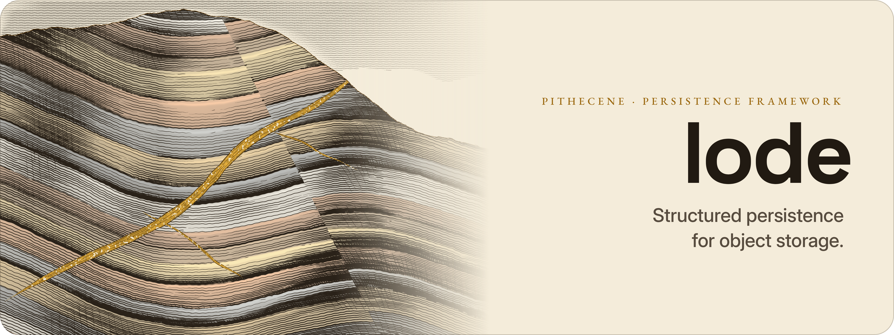

<picture>
  <source media="(prefers-color-scheme: dark)" srcset="docs/assets/lode-banner-dark.png">
  
</picture>

# Lode

**Structured persistence for object storage.**

[](https://pkg.go.dev/github.com/pithecene/lode)
[](https://github.com/pithecene/lode/releases/latest)
[](https://github.com/pithecene/lode/actions/workflows/ci.yml)
[](LICENSE)

Lode is an embeddable Go persistence framework that provides snapshots,
metadata, and safe write semantics on object storage, without requiring a
database. It offers **Datasets** for structured collections of named
objects and, in an experimental package (`lode/volume`), **Volumes** for
sparse, resumable storage of byte ranges.

---

## Quick Start

### Install

<!-- runnable -->
```bash
go get github.com/pithecene/lode
```

### Writing and Reading a Blob

<!-- illustrative: shows API pattern; see examples/ for runnable code -->
```go
package main

import (
    "context"
    "fmt"
    "github.com/pithecene/lode/lode"
)

func main() {
    ctx := context.Background()

    // Open a root over filesystem storage, and a blob dataset in it.
    blobs, _ := lode.Open(lode.FS("/tmp/lode-demo")).Blobs(ctx, "mydata")

    // Write a blob: one []byte per snapshot.
    snap, _ := blobs.Write(ctx, []byte("hello world"), lode.D{"source": "demo"})
    fmt.Println("Created snapshot:", snap.ID)

    // Read the blob back.
    data, _ := blobs.Read(ctx, snap.ID)
    fmt.Println("Data:", string(data))
}
```

### Writing Structured Records

<!-- illustrative: shows API pattern; see examples/ for runnable code -->
```go
// The codec fixes the record type: here Event, encoded as JSON Lines.
type Event struct {
    ID    int    `json:"id"`
    Event string `json:"event"`
    Day   string `json:"day"`
}

// Batch is the snapshot's metadata.
type Batch struct {
    Number int `json:"number"`
}

root := lode.Open(lode.FS("/tmp/lode-demo"))
events, _ := root.Records(ctx, "events", lode.JSONL[Event](),
    lode.WithLayout(lode.Hive("day").By(func(e Event) lode.Partition {
        return lode.Partition{"day": e.Day}
    })))

snap, _ := events.Write(ctx, []Event{
    {ID: 1, Event: "signup", Day: "2026-10-22"},
    {ID: 2, Event: "login", Day: "2026-10-22"},
}, Batch{Number: 1})
got, _ := events.Read(ctx, snap.ID) // []Event

var batch Batch
_ = snap.Metadata.Decode(&batch)

// A reader opens a view: it takes the layout from the manifests.
view, _ := lode.OpenReadOnly(lode.FS("/tmp/lode-demo")).Records(ctx, "events", lode.JSONL[Event]())
```

Lode stores data on the filesystem (`lode.FS`), in memory (`lode.Memory`),
or on S3-compatible storage (`s3.Factory`). The storage location must exist
before a dataset is opened (see [Storage
Prerequisites](PUBLIC_API.md#storage-prerequisites)). Streaming writes and
the experimental Volume API are described in [`PUBLIC_API.md`](PUBLIC_API.md),
and complete programs are listed in [`examples/`](examples/).

---

## Core Ideas

**Dataset** (structured collections):
- Each write produces a new, immutable snapshot.
- Each snapshot references a manifest that describes its data files and
  metadata.
- Storage, format, compression, and partitioning are independent.

**Volume** (sparse byte ranges; experimental package `lode/volume`):
- A volume is a sparse, resumable byte address space.
- Commits record which ranges exist; gaps are never filled with zeros.
- Each commit produces a cumulative manifest.

**Both:**
- A snapshot is visible only once its manifest is persisted.
- Metadata is explicit and persisted, never inferred.
- Every store detects concurrent writers through CAS.

---

## Guarantees

- **Immutable snapshots**: data files and manifests never change once
  written.
- **Atomic commits**: a snapshot is visible only once its manifest exists.
- **Explicit metadata**: every snapshot carries metadata supplied by the
  caller, never inferred.
- **Safe writes**: existing objects are never overwritten, and every store
  detects concurrent writers through CAS.

Lode does not coordinate distributed writers, execute queries, compact
data, or remove anything without being asked; [the concepts
guide](docs/guides/concepts.md#what-lode-guarantees) gives the details.

Version 1.0 accepts two limitations. A backend without a
conditional write serves writers in one process only, through
`SingleProcess`, and writers in several processes then need external
coordination ([Concurrency and
CAS](PUBLIC_API.md#concurrency-and-cas)). On an S3-compatible service other
than AWS S3, the guarantees depend on conditional writes and consistency
that Lode does not verify ([Other S3-Compatible
Services](PUBLIC_API.md#other-s3-compatible-services)).

---

## Documentation

| Topic | Where |
|-------|-------|
| Storage model, commits, and choosing a write API | [Concepts guide](docs/guides/concepts.md) |
| Complete API usage, options, and common pitfalls | [`PUBLIC_API.md`](PUBLIC_API.md) |
| Expiring snapshots and reclaiming residual data | [Retention guide](docs/guides/retention.md) |
| Snapshot ID format and ordering | [Snapshot ID guide](docs/guides/snapshot-ids.md) |
| Normative behavior | [`docs/contracts/`](docs/contracts/) |
| Runnable programs | [`examples/`](examples/) |
| Performance | [`docs/BENCHMARKS.md`](docs/BENCHMARKS.md) |
| Documentation conventions, for maintainers | [`docs/maintainers/`](docs/maintainers/) |

---

## Status

Lode is at **v0.12.0** and under active development. Its APIs are
stabilizing; the breaking changes still under consideration for v1.0 are
listed in [`docs/plans/V1_API_DECISIONS.md`](docs/plans/V1_API_DECISIONS.md), and each
release is described in [`CHANGELOG.md`](CHANGELOG.md).

---

## License

Apache License 2.0 (see [`LICENSE`](LICENSE)). Copyright © 2026 Pithecene LLC.

Contact: contact@pithecene.sh. To report a vulnerability, follow
[`SECURITY.md`](SECURITY.md).
