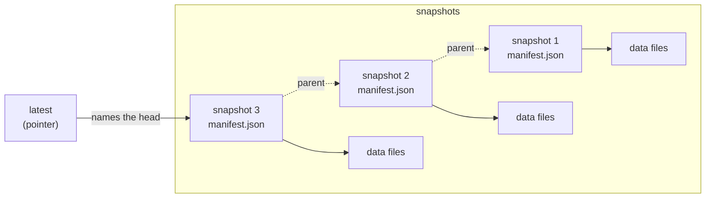
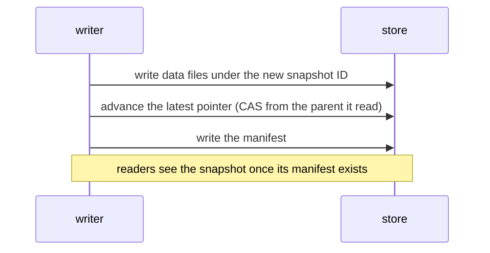
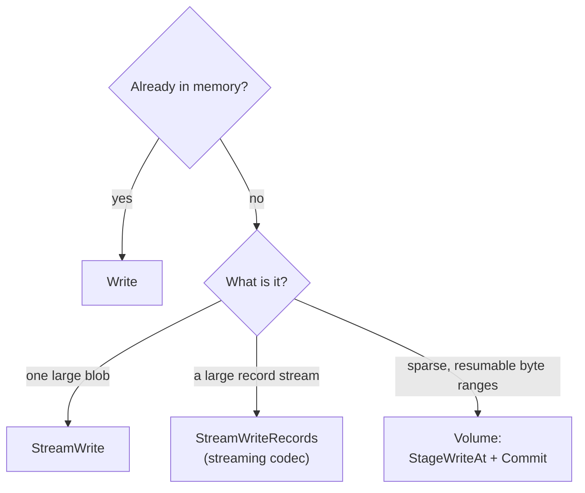

<picture>
  <source media="(prefers-color-scheme: dark)" srcset="docs/assets/lode-splash-dark.jpg">
  
</picture>

# Lode

**Structured persistence for object storage.**

[](https://pkg.go.dev/github.com/pithecene-io/lode)
[](https://github.com/pithecene/lode/releases/latest)
[](https://github.com/pithecene/lode/actions/workflows/ci.yml)
[](LICENSE)

Lode is an embeddable Go persistence framework that provides snapshots,
metadata, and safe write semantics on object storage, without requiring a
database. It offers **Datasets** for structured collections of named
objects and, in an experimental package (`lode/volume`), **Volumes** for
sparse, resumable storage of byte ranges.

---

## Quick Start

### Install

<!-- runnable -->
```bash
go get github.com/pithecene-io/lode
```

### Writing and Reading a Blob

<!-- illustrative: shows API pattern; see examples/ for runnable code -->
```go
package main

import (
    "context"
    "fmt"
    "github.com/pithecene-io/lode/lode"
)

func main() {
    ctx := context.Background()

    // Create dataset with filesystem storage
    ds, _ := lode.NewDataset("mydata", lode.NewFSFactory("/tmp/lode-demo"))

    // Write a blob (default: raw bytes, no codec)
    snap, _ := ds.Write(ctx, []any{[]byte("hello world")}, lode.Metadata{"source": "demo"})
    fmt.Println("Created snapshot:", snap.ID)

    // Read it back
    data, _ := ds.Read(ctx, snap.ID)
    fmt.Println("Data:", string(data[0].([]byte)))
}
```

### Writing Structured Records

<!-- illustrative: shows API pattern; see examples/ for runnable code -->
```go
// With a codec, Write accepts structured data
ds, _ := lode.NewDataset("events",
    lode.NewFSFactory("/tmp/lode-demo"),
    lode.WithCodec(lode.NewJSONLCodec()),
)

records := lode.R(
    lode.D{"id": 1, "event": "signup"},
    lode.D{"id": 2, "event": "login"},
)
snap, _ := ds.Write(ctx, records, lode.Metadata{"batch": "1"})
```

### Streaming Large Files

<!-- illustrative: shows API pattern; see examples/ for runnable code -->
```go
// StreamWrite is for large binary payloads (no codec)
ds, _ := lode.NewDataset("backups", lode.NewFSFactory("/tmp/lode-demo"))

sw, _ := ds.StreamWrite(ctx, lode.Metadata{"type": "backup"})
sw.Write([]byte("... large data ..."))
snap, _ := sw.Commit(ctx)
```

### Writing Sparse Byte Ranges (Volume, Experimental)

<!-- illustrative: shows API pattern; see examples/ for runnable code -->
```go
// Volume: sparse, resumable byte-range persistence (package lode/volume)
vol, _ := volume.New("disk-image", lode.NewFSFactory("/tmp/lode-demo"), 1024)

// Stage a byte range and commit
blk, _ := vol.StageWriteAt(ctx, 0, bytes.NewReader(data))
snap, _ := vol.Commit(ctx, []volume.BlockRef{blk}, lode.Metadata{"step": "boot"})

// Read it back
result, _ := vol.ReadAt(ctx, snap.ID, 0, len(data))
```

See [`examples/`](#examples) for complete runnable code.

---

## Core Ideas

**Dataset** (structured collections):
- Each write produces a new, immutable snapshot.
- Each snapshot references a manifest that describes its data files and
  metadata.
- Storage, format, compression, and partitioning are independent.

**Volume** (sparse byte ranges; experimental package `lode/volume`):
- A volume is a sparse, resumable byte address space.
- Commits record which ranges exist; gaps are never filled with zeros.
- Each commit produces a cumulative manifest.

**Both:**
- A snapshot is visible only once its manifest is persisted.
- Metadata is explicit and persisted, never inferred.
- Stores that support CAS detect concurrent writers.

---

## How Storage and Commits Work

A dataset in storage, in the default layout:



Each write adds a snapshot, and nothing written earlier changes. A commit
becomes visible in a fixed sequence:



If another writer advanced the pointer first, the CAS fails with
`ErrSnapshotConflict`. With `WithRetryCount`, Lode reads the head again and
retries with the same staged data, which may still publish the snapshot. If
the commit fails permanently, the data files that a buffered write staged
remain as orphaned objects until `Dataset.Sweep` reclaims them; a stream
write deletes its object on a best-effort basis.

---

## What Lode Is and Is Not

**Lode is:**
- an embeddable Go library;
- a persistence framework for structured data and sparse byte ranges;
- a provider of snapshots, atomic commits, and metadata guarantees that
  would otherwise have to be implemented by hand on raw storage APIs; and
- explicit and predictable by design.

**Lode is not:**
- a database or storage engine;
- a query planner or execution runtime; or
- a distributed system or background service.

Lode governs *structure and lifecycle*, not execution.

---

## Why Lode Exists

Many systems already use object storage as their primary persistence layer:

- events written to S3;
- Parquet files on a filesystem; and
- analytics data deposited according to informal convention.

What such systems usually lack is discipline:
- no clear snapshots or versions;
- no guarantees about metadata;
- accidental overwrites;
- improvised directory layouts; and
- uncertain safety of reads and writes.

Lode formalizes what should be formalized and declines to do anything
else.

---

## Choosing a Write API

| Paradigm | API | Use Case | Codec | Partitioning |
|----------|-----|----------|-------|--------------|
| Dataset | `Write` | In-memory data, small batches | ✅ Optional | ✅ Supported |
| Dataset | `StreamWrite` | Large binary payloads (gigabytes or more) | ❌ Raw only | ❌ Not supported |
| Dataset | `StreamWriteRecords` | Large streams of records | ✅ Required (streaming) | ❌ Not supported |
| Volume (experimental) | `StageWriteAt` + `Commit` | Sparse, resumable byte ranges | ❌ Raw only | ❌ Not applicable |

**Decision procedure:**
1. If the data is already in memory, use `Write`.
2. If it is a large, unstructured binary object, use `StreamWrite`.
3. If it is a large stream of records, use `StreamWriteRecords` with a
   streaming codec.
4. If it is a sparse, resumable byte address space, use `volume.Volume`
   (experimental).



---

## Guarantees

Lode guarantees the following:

| Guarantee | Detail |
|-----------|--------|
| **Immutable snapshots** | Once written, data files and manifests never change |
| **Atomic commits** | The presence of a manifest signifies a commit; nothing is partially visible |
| **Explicit metadata** | Every snapshot carries metadata supplied by the caller (never inferred) |
| **Safe writes** | Overwrites are prevented, atomically for standard writes on every built-in adapter. Large uploads (above 5 GB) are atomic when the backend supports conditional completion of multipart uploads, and best-effort otherwise ([details](PUBLIC_API.md#large-upload-guarantees)). |
| **Independence from the backend** | The same semantics on the filesystem, in memory, or on S3 |

Lode explicitly does **not** provide the following:

| Non-Goal | Reason |
|----------|--------|
| Distributed coordination | Lode detects conflicts (CAS) but provides no locks, consensus, or leader election |
| Query execution | Lode structures data; query engines consume it |
| Background compaction | Lode performs no implicit mutation; callers control the lifecycle |
| Automatic removal | Nothing is removed implicitly; `Expire` and `Sweep` remove snapshots and residual data when the caller invokes them (see [the retention guide](docs/guides/retention.md)) |

The complete contracts are in [`docs/contracts/`](docs/contracts/).

---

## Common Pitfalls

- **Metadata defaults to empty**: `nil` metadata is converted to
  `Metadata{}`; pass either `nil` or `Metadata{}` for empty metadata.
- **Raw mode expects `[]byte`**: without a codec, `Write` expects exactly
  one `[]byte` element.
- **Concurrent writes require a store that supports CAS**: without
  `ConditionalWriter`, concurrent writers may corrupt the history. The
  built-in memory and S3 adapters support CAS; the filesystem adapter
  supports it on Unix only (elsewhere it uses Delete+Put and requires a
  single writer).
- **Removal of partial objects is best-effort**: failed streams may leave
  partial objects in storage until `Dataset.Sweep` reclaims them after its
  grace period.
- **`StreamWriteRecords` requires a streaming codec**: not every codec
  supports streaming.

See [`PUBLIC_API.md`](PUBLIC_API.md) for complete guidance on usage.

---

## Example: Event Storage

A typical Lode workflow has the following configuration:

- Dataset: `events`
- Rows: events with timestamps
- Partitioning: Hive style, by day (`dt=YYYY-MM-DD`)
- Format: JSON Lines
- Compression: gzip
- Backend: filesystem or S3

Each write produces a new snapshot, and every read targets a snapshot
explicitly.

---

## Supported Backends

- **Filesystem**: local storage through `NewFSFactory`
- **In memory**: testing through `NewMemoryFactory`
- **S3**: AWS S3, MinIO, LocalStack, and R2 through `lode/s3`

---

## Storage Prerequisites

**Ensure that storage exists before constructing a dataset, volume, or
reader.**

Lode does not create storage infrastructure. This is deliberate:
- Constructors have no concealed side effects.
- Explicit provisioning leaves control with the caller.
- The same pattern applies to every backend.

### Filesystem

```bash
# Create directory before use
mkdir -p /data/lode
```

<!-- illustrative -->
```go
// Then construct dataset
ds, err := lode.NewDataset("events", lode.NewFSFactory("/data/lode"))
```

### S3

```bash
# Create bucket before use (via AWS CLI, console, or IaC)
aws s3 mb s3://my-bucket
```

<!-- illustrative -->
```go
// Then construct dataset (wrap Store in factory)
store, err := s3.New(client, s3.Config{Bucket: "my-bucket"})
factory := func() (lode.Store, error) { return store, nil }
ds, err := lode.NewDataset("events", factory)
```

### Bootstrap Helpers

Provisioning helpers, if needed, belong outside the core APIs:

<!-- illustrative -->
```go
// Example: ensure directory exists before constructing dataset
func EnsureFSDataset(id, root string, opts ...lode.Option) (lode.Dataset, error) {
    if err := os.MkdirAll(root, 0755); err != nil {
        return nil, fmt.Errorf("create storage root: %w", err)
    }
    return lode.NewDataset(id, lode.NewFSFactory(root), opts...)
}
```

This arrangement keeps Lode's core APIs explicit and predictable.

---

## Examples

| Example | Purpose | Run |
|---------|---------|-----|
| [`default_layout`](examples/default_layout) | Writing, listing, and reading with the default layout | `go run ./examples/default_layout` |
| [`hive_layout`](examples/hive_layout) | A partition-first layout with the Hive partitioner | `go run ./examples/hive_layout` |
| [`blob_upload`](examples/blob_upload) | Writing and reading a raw blob (no codec, default components) | `go run ./examples/blob_upload` |
| [`manifest_driven`](examples/manifest_driven) | The manifest as the signal of a commit | `go run ./examples/manifest_driven` |
| [`stream_write_records`](examples/stream_write_records) | Streaming record writes with an iterator | `go run ./examples/stream_write_records` |
| [`parquet`](examples/parquet) | The Parquet codec with schema-typed fields | `go run ./examples/parquet` |
| [`volume_sparse`](examples/volume_sparse) | A sparse Volume: staging, committing, and reading with gaps | `go run ./examples/volume_sparse` |
| [`vector_artifacts`](examples/vector_artifacts) | A vector artifact pipeline: embeddings, indices, and pointers | `go run ./examples/vector_artifacts` |
| [`optimistic_concurrency`](examples/optimistic_concurrency) | CAS conflict detection and the retry pattern | `go run ./examples/optimistic_concurrency` |
| [`retention`](examples/retention) | Expiring runs by partition after a preview, then sweeping | `go run ./examples/retention` |
| [`s3`](examples/s3) | The S3 adapter with LocalStack or MinIO | `go run ./examples/s3` |

Each example is self-contained and runnable; its source contains detailed
comments.

---

## Status

Lode is at **v0.10.0** and under active development. Its APIs are
stabilizing; the breaking changes still under consideration for v1.0 are
listed once, with the scope of their effect, in
[`docs/V1_API_DECISIONS.md`](docs/V1_API_DECISIONS.md).

v0.10.0 adds nightly mutation-testing gates and the corrections they
prompted (an atomic `Put`, stream writes that fail early, and a bounded
`ReadRange`). It completes the listing API with cursors and a deterministic
order, classifies every rejected argument under `ErrInvalidArgument`, and
reorganizes the internals around a single head-pointer protocol, a single
path grammar, and a single write pipeline, without any change to the
stored format and with benchmark results unchanged. Stores that support CAS
(memory, S3, and the filesystem on Unix) detect concurrent writers; other
stores require a single writer.

An evaluation of Lode should concentrate on:
- snapshot semantics (Dataset and Volume);
- the visibility of metadata; and
- the clarity of the API.

- Overview of usage: [`PUBLIC_API.md`](PUBLIC_API.md)
- Examples of usage: [`examples/`](examples/)
- Benchmarks: [`docs/BENCHMARKS.md`](docs/BENCHMARKS.md)
- Implementation milestones:
  [`docs/IMPLEMENTATION_PLAN.md`](docs/IMPLEMENTATION_PLAN.md)

---

## License
Apache License 2.0. Copyright © 2026 Andrew Hu <me@andrewhu.nyc>.
