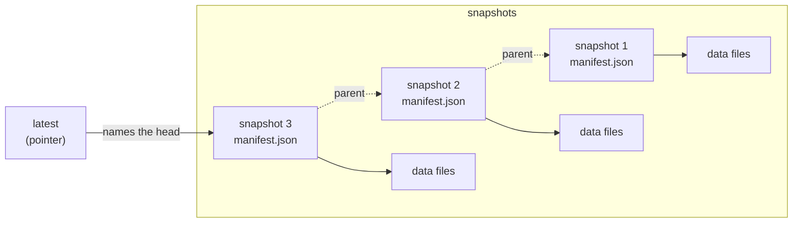
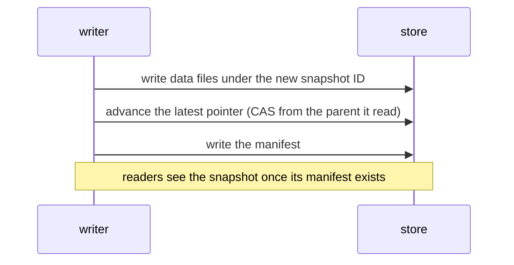
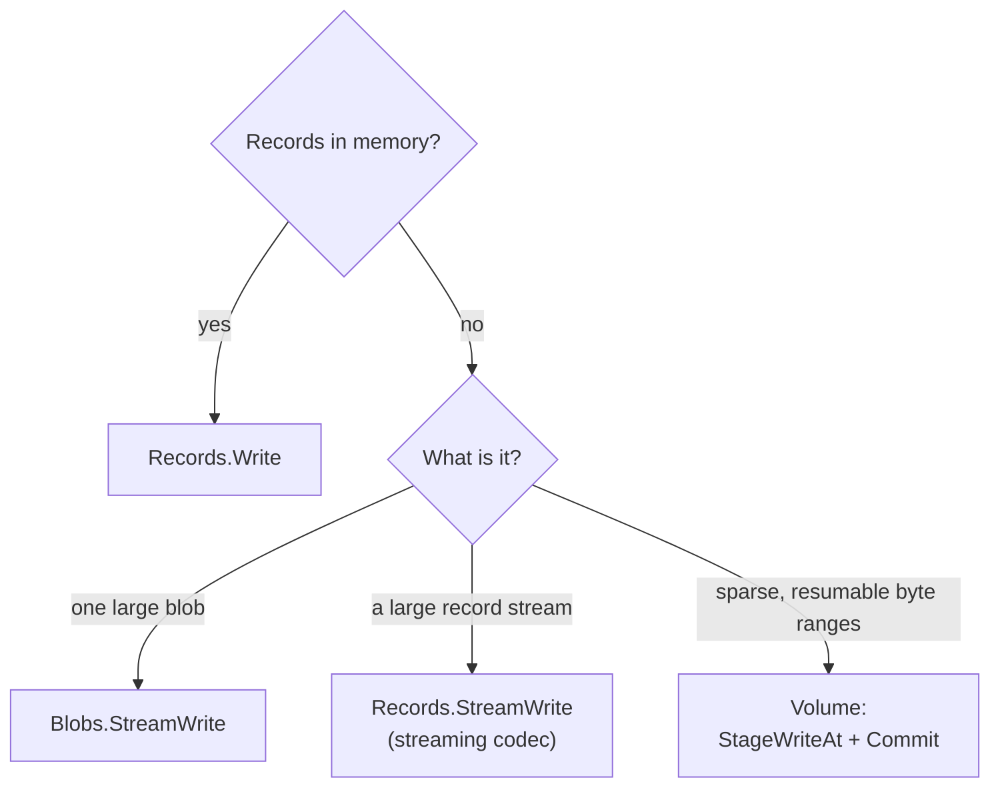

# How Lode Stores and Commits Data

This guide describes what Lode is, how a dataset is arranged in storage,
how a commit becomes visible, and how to choose among the write APIs. It is
explanatory, and the normative rules are defined in the contracts under
[`docs/contracts/`](../contracts/), principally
[`CONTRACT_CORE.md`](../contracts/CONTRACT_CORE.md) and
[`CONTRACT_WRITE_API.md`](../contracts/CONTRACT_WRITE_API.md).

## What Lode Is and Is Not

**Lode is:**
- an embeddable Go library
- a persistence framework for structured data and sparse byte ranges
- a provider of snapshots, atomic commits, and metadata guarantees that
  would otherwise have to be implemented by hand on raw storage APIs
- explicit and predictable by design

**Lode is not:**
- a database or storage engine
- a query planner or execution runtime
- a distributed system or background service

Lode governs *structure and lifecycle*, not execution.

## Why Lode Exists

Many systems already use object storage as their primary persistence layer:

- events written to S3
- Parquet files on a filesystem
- analytics data deposited according to informal convention

What such systems usually lack is discipline:
- no clear snapshots or versions
- no guarantees about metadata
- accidental overwrites
- improvised directory layouts
- uncertain safety of reads and writes

Lode formalizes what should be formalized and declines to do anything
else.

## Storage and Commits

A dataset in storage, in the default layout:

Each write adds a snapshot, and nothing written earlier changes. A commit
becomes visible in a fixed sequence:

If another writer advanced the pointer first, the CAS fails with
`ErrSnapshotConflict`. With `WithRetryCount`, Lode reads the head again and
retries with the same staged data, which may still publish the snapshot. If
the commit fails permanently, the data files that a buffered write staged
remain as orphaned objects until `Sweep` reclaims them. A stream
write deletes its object on a best-effort basis if the commit failed before
any manifest write, and retains it otherwise, because a manifest whose
write reported an error may still have been stored.

## Choosing a Write API

| Handle | API | Use Case | Codec | Partitioning |
|----------|-----|----------|-------|--------------|
| `Records[T]` | `Write` | Records in memory, batches | ✅ Fixes `T` | ✅ Supported |
| `Records[T]` | `StreamWrite` | Large streams of records (`iter.Seq2[T, error]`) | ✅ Must stream | ❌ Not supported |
| `Blobs` | `Write` | One blob in memory | ❌ Raw bytes | ❌ Not applicable |
| `Blobs` | `StreamWrite` | Large binary payloads (gigabytes or more) | ❌ Raw bytes | ❌ Not applicable |
| Volume (experimental) | `StageWriteAt` + `Commit` | Sparse, resumable byte ranges | ❌ Raw only | ❌ Not applicable |

**Decision procedure:**
1. If the data is records already in memory, use `Records.Write`.
2. If it is a large, unstructured binary object, use `Blobs.StreamWrite`
   (or `Blobs.Write` for one in memory).
3. If it is a large stream of records, use `Records.StreamWrite` with a
   streaming codec.
4. If it is a sparse, resumable byte address space, use `volume.Volume`
   (experimental).

## A Typical Workflow for Event Storage

A typical Lode workflow has the following configuration:

- Root: `lode.Open(lode.FS(dir))` or `lode.Open(s3.Factory(client, cfg))`
- Dataset: `events`, opened as `Records[Event]` with `lode.JSONL[Event]()`
- Rows: events with timestamps (`Event` implements `Timestamped`)
- Partitioning: Hive style, by day (`dt=YYYY-MM-DD`), with
  `lode.Hive("dt").By(...)`
- Format: JSON Lines
- Compression: gzip
- Backend: filesystem or S3

Each write produces a new snapshot, and every read targets a snapshot
explicitly. A reader opens a view, which takes the layout, codec name, and
compressor from the dataset's manifests rather than repeating them.

## What Lode Guarantees

Lode guarantees the following:

| Guarantee | Detail |
|-----------|--------|
| **Immutable snapshots** | Once written, data files and manifests never change |
| **Atomic commits** | The presence of a manifest signifies a commit, and nothing is partially visible |
| **Explicit metadata** | Every snapshot carries metadata supplied by the caller (never inferred) |
| **Safe writes** | Overwrites are prevented, atomically for standard writes on every built-in adapter. Large uploads (above 5 GB) are atomic when the backend supports conditional completion of multipart uploads, and best-effort otherwise ([details](../../PUBLIC_API.md#large-upload-guarantees)). |
| **Independence from the backend** | The same semantics on the filesystem, in memory, or on S3 |

Lode explicitly does **not** provide the following:

| Non-Goal | Reason |
|----------|--------|
| Distributed coordination | Lode detects conflicts (CAS) but provides no locks, consensus, or leader election |
| Query execution | Lode structures data, and query engines consume it |
| Background compaction | Lode performs no implicit mutation, and callers control the lifecycle |
| Automatic removal | Nothing is removed implicitly, and `Expire` and `Sweep` remove snapshots and residual data when the caller invokes them (see [the retention guide](retention.md)) |

The complete contracts are in [`docs/contracts/`](../contracts/).
