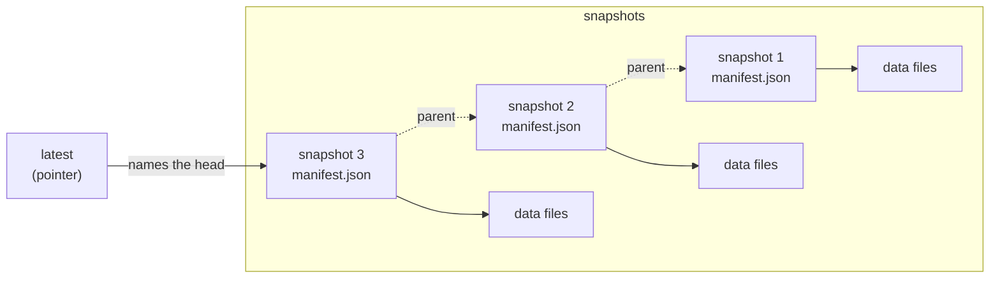
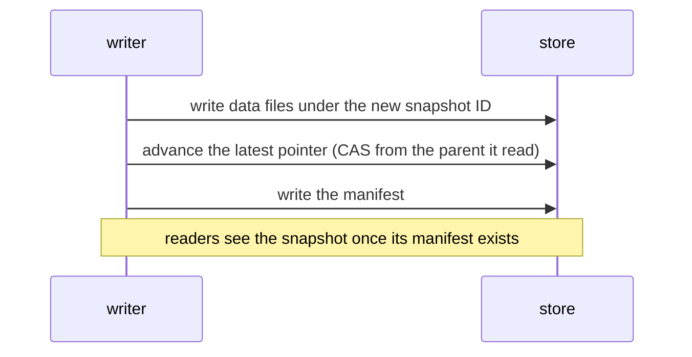
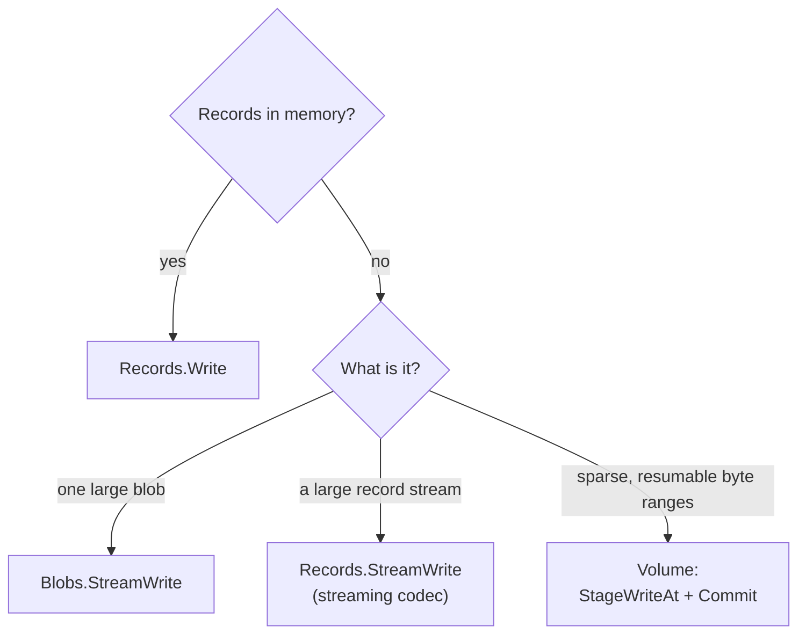

# Lode Storage and Commit Model

This guide describes Lode's purpose, the arrangement of a dataset in
storage, the sequence that makes a commit visible, and the selection of a
write API. The guide explains the design, and the contracts under
[`docs/contracts/`](../contracts/) define the normative rules, principally
[`CONTRACT_CORE.md`](../contracts/CONTRACT_CORE.md) and
[`CONTRACT_WRITE_API.md`](../contracts/CONTRACT_WRITE_API.md).

## Scope and Exclusions of Lode

Lode has the following characteristics:
- an embeddable Go library
- a persistence framework for structured data and sparse byte ranges
- a provider of snapshots, atomic commits, and metadata guarantees that
  callers would otherwise implement by hand on raw storage APIs
- a library with explicit and predictable behavior by design

Lode excludes the following roles:
- a database or storage engine
- a query planner or execution runtime
- a distributed system or background service

Lode governs the *structure and lifecycle* of data, not its execution, so
callers supply their own query engines and process scheduling.

## Undisciplined Object Storage

Many systems already use object storage as their primary persistence layer:

- events written to S3
- Parquet files on a filesystem
- analytics data deposited according to informal convention

Such systems usually lack discipline and show the following faults:
- absent snapshots or versions
- absent metadata guarantees
- accidental overwrites
- improvised directory layouts
- uncertain read and write safety

Lode formalizes snapshots, commits, metadata, and directory layout, and it
leaves execution, coordination, and compaction to the caller.

## Storage and Commits

The following diagram shows a dataset in storage under the default layout:

Each write adds a snapshot, and nothing written earlier changes. A commit
becomes visible in a fixed sequence:

If another writer advanced the pointer first, the CAS fails with
`ErrSnapshotConflict`. With `WithRetry`, Lode reads the head again and
retries the commit with the same staged data, and the retry may still
publish the snapshot. If the commit fails permanently, the data files that
a buffered write staged remain as orphaned objects until `Sweep` reclaims
them. A stream write deletes its object on a best-effort basis if the
commit fails before any manifest write. Otherwise, the stream write retains
the object, because the store may have persisted a manifest even when its
write reported an error.

## Choosing a Write API

| Handle | API | Use Case | Codec | Partitioning |
|----------|-----|----------|-------|--------------|
| `Records[T]` | `Write` | Records in memory, batches | ✅ Fixes `T` | ✅ Supported |
| `Records[T]` | `StreamWrite` | Large streams of records (`iter.Seq2[T, error]`) | ✅ Must stream | ❌ Not supported |
| `Blobs` | `Write` | One blob in memory | ❌ Raw bytes | ❌ Not applicable |
| `Blobs` | `StreamWrite` | Large binary payloads (gigabytes or more) | ❌ Raw bytes | ❌ Not applicable |
| Volume (experimental) | `StageWriteAt` + `Commit` | Sparse, resumable byte ranges | ❌ Raw bytes | ❌ Not applicable |

The following procedure selects a write API:
1. If the data is records already in memory, use `Records.Write`.
2. If it is a large, unstructured binary object, use `Blobs.StreamWrite`
   (or `Blobs.Write` for one in memory).
3. If it is a large stream of records, use `Records.StreamWrite` with a
   streaming codec.
4. If it is a sparse, resumable byte address space, use `volume.Volume`
   (experimental).

## A Typical Workflow for Event Storage

A typical Lode workflow has the following configuration:

- Root: `lode.Open(lode.FS(dir))` or `lode.Open(s3.Factory(client, cfg))`
- Dataset: `events`, opened as `Records[Event]` with `lode.JSONL[Event]()`
- Rows: events with timestamps (`Event` implements `Timestamped`)
- Partitioning: Hive style, by day (`dt=YYYY-MM-DD`), with
  `lode.Hive("dt").By(...)`
- Format: JSON Lines
- Compression: gzip
- Backend: filesystem or S3

Each write produces a new snapshot, and every read targets a snapshot
explicitly. A reader opens a view, which reads the layout, codec name, and
compressor from the dataset's manifests, so the caller does not repeat
them.

## Guarantees and Non-Goals

Lode guarantees the following:

| Guarantee | Detail |
|-----------|--------|
| **Immutable snapshots** | Once written, data files and manifests never change |
| **Atomic commits** | The presence of a manifest signifies a commit, and nothing is partially visible |
| **Explicit metadata** | Every snapshot carries metadata that the caller supplies, and Lode never infers metadata |
| **Safe writes** | Lode prevents overwrites atomically for standard writes on every built-in adapter. Large uploads (above 5 GB) are atomic when the backend supports conditional multipart-upload completion, and best-effort otherwise ([details](../../PUBLIC_API.md#large-upload-guarantees)). |
| **Backend independence** | The same semantics on the filesystem, in memory, or on S3 |

Lode explicitly does **not** provide the following:

| Non-Goal | Reason |
|----------|--------|
| Distributed coordination | Lode detects conflicts (CAS) but provides no locks, consensus, or leader election |
| Query execution | Lode structures data, and query engines consume it |
| Background compaction | Lode performs no implicit mutation, and callers control the lifecycle |
| Automatic removal | Lode removes nothing implicitly, and `Expire` and `Sweep` remove snapshots and residual data when the caller invokes them (see [the retention guide](retention.md)) |

The complete contracts are in [`docs/contracts/`](../contracts/).
