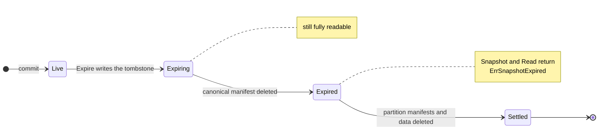
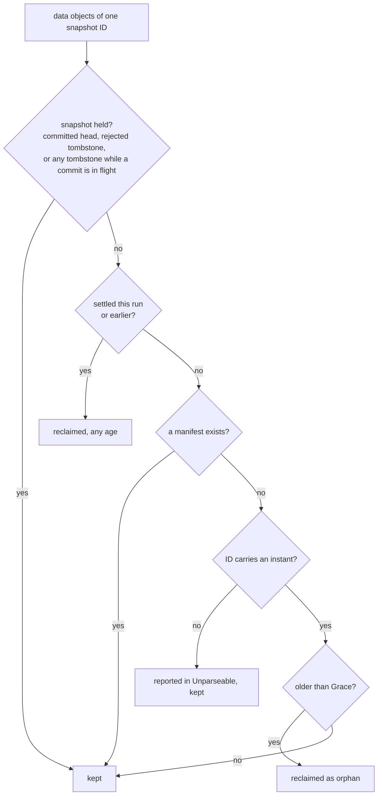

# Retention: expiring snapshots and sweeping leftovers

This guide explains how to remove old data from a Lode dataset with
`Dataset.Expire` and `Dataset.Sweep`, what Lode does underneath, and why.
It is explanatory: the rules live in
[`CONTRACT_RETENTION.md`](../contracts/CONTRACT_RETENTION.md), and where the
two differ, the contract wins.

## The two operations

| | `Expire` | `Sweep` |
|---|---|---|
| Removes | Snapshots you select, with their manifests and data | Leftovers: the rest of interrupted expiries, and data of writes that never committed |
| You choose | Which snapshots (`IDs`, `Partition`, `Before`) | How old an uncommitted write must be before it is reclaimed (`Grace`) |
| Typical cadence | Whenever your policy says data is no longer needed | Periodically, for example daily |

Both take a `DryRun` flag that reports exactly what a real run would do
without changing anything, and both always return a report, even with an
error, describing the work done before it.

Lode decides nothing on its own: no background job runs, and nothing is
removed unless you call one of these. Which snapshots to keep is your
policy; Lode provides the safe primitive.

## The life of an expired snapshot



- **Live**: the snapshot has its manifests and data, and no tombstone.
- **Expiring**: a tombstone exists, but the canonical manifest is still
  there. The snapshot is fully readable; the expiry is only decided.
- **Expired**: the canonical manifest is gone. `Snapshot` and `Read` return
  `ErrSnapshotExpired`, which also matches `ErrNotFound`, so a caller can tell
  "removed on purpose" from "never existed".
- **Settled**: every manifest and data object is gone; only the tombstone
  remains, permanently.

A snapshot written before canonical manifests existed (old Hive datasets)
has no canonical manifest, so its tombstone alone makes it expired.

## What a tombstone is

A tombstone is a small object at `<dataset>/expired/<snapshot ID>`, written
**before anything is deleted**. It records:

- the snapshot ID,
- when the expiry was requested,
- the manifest's `CreatedAt`, and
- the snapshot's inventory: every data file's path and size, copied from
  the manifest.

Writing it is the point of no return: once it exists, the expiry is carried
through to the end, by the same run, by the next `Expire` that names the ID,
or by `Sweep`. That is what makes expiry **resumable**. A crash between
deletes would otherwise leave data that no manifest describes and no record
explains; with the tombstone, every later step works from the inventory it
carries, never from manifests that may already be gone. The recorded sizes
are also how a resumed run can still report `Bytes`.

Tombstones are never removed. Expiry is recorded by writing a new object,
never by editing an existing one, which is how retention keeps Lode's rule
that committed state is never rewritten.

A tombstone only ever acts on a manifest it **describes**: one with the same
`CreatedAt` and the same file list. A tombstone that is unreadable, or that
contradicts a manifest still present, is reported (`SweepReport.Unparseable`
or an `Expire` error) and never acted on. Lode never rewrites or removes a
tombstone to recover; corruption is left for an operator.

## How `Expire` removes one snapshot


Every step can be repeated: a step that finds its target already gone
succeeds. If the process stops at any point, the next `Expire` naming the
same ID, or the next `Sweep`, carries on from the tombstone.

### Selecting snapshots

- `IDs`: these snapshots, including any whose expiry an earlier run started
  but did not finish.
- `Partition`: snapshots with a manifest in that partition or beneath it
  (Hive layouts). Matching is by whole path segment, so `run_id=run-1` never
  selects `run_id=run-10`. A snapshot with files outside the partition is
  kept and reported in `Mixed`; to expire it, name it in `IDs` in a request
  without `Partition` (fields intersect, so adding `IDs` alongside
  `Partition` still reports it as mixed).
- `Before`: snapshots whose write began before an instant. The instant is
  read from the snapshot ID, so selecting loads no manifest.

Fields combine by intersection, and a request with none of them is
rejected with `ErrInvalidArgument`.

### The head is never expired

The snapshot the `latest` pointer names is kept and reported in
`RetainedHead`, even when your selection includes it. Selecting the head is
not an error, so a `Before` request on a dataset with no newer writes still
works; run it again after a newer commit to remove what was retained.

Only the pointer names the head. Retention never guesses it from snapshot
IDs, because a clock that went backwards can give the last commit the
smaller ID. So `Expire` returns `ErrHeadUncommitted` when:

- the pointer names a snapshot whose manifest is not written yet (a commit
  in flight): retry once it lands. Found before the run starts, nothing is
  expired; found at the check before a later snapshot, the snapshots
  already expired stay expired and the report lists them. A pointer left
  by a crashed commit stays until the next commit replaces it: `Latest`
  never rewrites a pointer, because it cannot tell a crashed commit from
  one still in flight;
- the dataset has snapshots, or tombstones, but no pointer (written before
  the pointer existed): nothing is expired. Any commit creates the
  pointer, after which retention runs.

A pointer that does not hold a snapshot ID Lode could have written is
corruption, and retention fails rather than trust it.

## How `Sweep` cleans up

`Sweep` does two things in one run.

**It settles interrupted expiries.** For each tombstone whose snapshot
still has manifests or data, it checks the tombstone against every manifest
copy, deletes the manifests, and then reclaims the data, regardless of the
grace period: the tombstone already records the decision. Three kinds are
held instead and their data kept: a tombstone naming the committed head
(Lode never writes one, so it is misplaced); every tombstone while a commit
is in flight, since the head is then unknown; and a tombstone that is
invalid or contradicts a manifest copy, which is reported in
`Unparseable`.

**It reclaims orphans.** A data object whose snapshot has neither a
manifest nor a tombstone, and that is older than `Grace`, belongs to a write
that never committed (an aborted stream, a crashed process) and is deleted.



`Sweep` does not take a listing's word that a manifest is gone: before
settling a snapshot the listing shows something of, or reclaiming an
orphan, it checks the manifest paths in the store, because a store's
listing can lag behind its writes. A tombstoned snapshot the listing shows
nothing of is not probed in that run; a later run whose listing shows its
leftovers handles them.

Reclaim works per snapshot, not per file. Every object under a live
snapshot's data prefix is kept, whether or not its manifest lists it, and
everything under a settled snapshot's prefix goes. Apart from the manifests
of snapshots it settles, `Sweep` touches nothing outside the layout's data
paths: sidecars such as `partitions/<k=v>/run.json` are yours to manage,
and the pointer and tombstones are never deleted.

### Choosing a grace period

`Grace` has no default and must be positive. An in-flight write has data
objects but no manifest yet, so to `Sweep` it looks exactly like an aborted
one; only age tells them apart. Age is measured from the instant in the
snapshot ID, taken on the **writer's** clock, so choose a grace longer than:

- the longest write you expect, **plus**
- the largest clock difference between any writing host and the sweeping
  one (skew, or a clock that went backwards).

24 hours is a conservative starting point.

## A typical schedule

A crawler that writes each run into a Hive dataset partitioned by
`run_id`, and keeps raw runs only until they are imported, might run:

<!-- illustrative -->
```go
// Once a run is imported downstream, expire its raw snapshots.
preview, err := ds.Expire(ctx, lode.ExpireRequest{Partition: "run_id=" + runID, DryRun: true})
// ... inspect preview.Expired, preview.Mixed, preview.Bytes ...
report, err := ds.Expire(ctx, lode.ExpireRequest{Partition: "run_id=" + runID})

// Separately, on a daily timer:
swept, err := ds.Sweep(ctx, lode.SweepRequest{Grace: 24 * time.Hour})
```

The runnable version is [`examples/retention`](../../examples/retention).

## Reading the reports

| Field | Meaning |
|---|---|
| `ExpireReport.Expired` | Snapshots expired (or that would be, on a dry run) |
| `ExpireReport.Mixed` | Snapshots kept because they span outside `Partition` |
| `ExpireReport.RetainedHead` | The head, if your selection included it |
| `ExpireReport.Skipped` | Inventory paths that are not this snapshot's data objects; left in place |
| `SweepReport.Settled` | Interrupted expiries whose remaining manifests this run found and removed; one whose manifests were already gone has its data reclaimed without being listed here |
| `SweepReport.Orphans` | Objects of writes that never committed |
| `SweepReport.Unparseable` | Tombstones Lode cannot trust, and objects whose ID carries no instant; nothing listed is deleted |
| `Objects`, `Bytes`, `Unsized` | What was deleted, as the run's listing showed it; sizes come from tombstone inventories, and objects with no recorded size are counted in `Unsized` |

Counts are as exact as the store's listing: runs that overlap can both count
an object, and an object a lagging listing omitted is deleted without being
counted.

## Known limits

- **A late partition manifest.** On a Hive layout, a commit can still be
  writing its partition manifests when a later commit moves the head and an
  `Expire` removes its snapshot. The slow writer can then add a partition
  manifest after the expiry; `ListManifests` and `ListPartitions` may show it
  until the next `Sweep` or `Expire` removes it. Leaving a margin in `Before`
  avoids it.
- **Snapshot ID collisions.** IDs are unique up to a 64-bit random
  collision within one nanosecond (see [snapshot IDs](snapshot-ids.md)).
  Should one happen, retention refuses to act on the older tombstone unless
  the new manifest has the same commit time and files, but data the new
  write stages before its manifest exists could be reclaimed.

## Errors you may see

| Error | Meaning | What to do |
|---|---|---|
| `ErrHeadUncommitted` | `Expire`: a commit is in flight. Both: the dataset has snapshots or tombstones but no pointer. (`Sweep` with a commit in flight succeeds, settling nothing that run.) | Retry; for a dataset written before the pointer existed, make one commit |
| `ErrSnapshotExpired` | The snapshot you read was expired (also matches `ErrNotFound`) | Expected after expiry |
| `ErrInvalidArgument` | An `ExpireRequest` with no selector, or a non-positive `Grace` | Fix the request |
| `ErrInvalidPath` | `Partition` is not a canonical relative partition path | Fix the partition path |
| `ErrPartitionPrefixNotSupported` | `Partition` on a layout without partitions | Select by `IDs` or `Before` |
