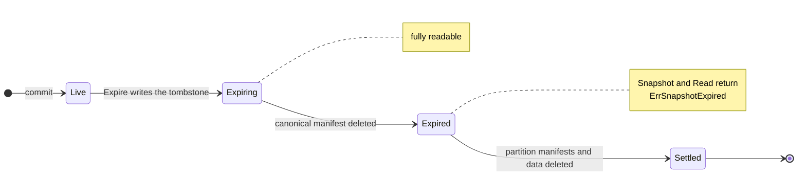
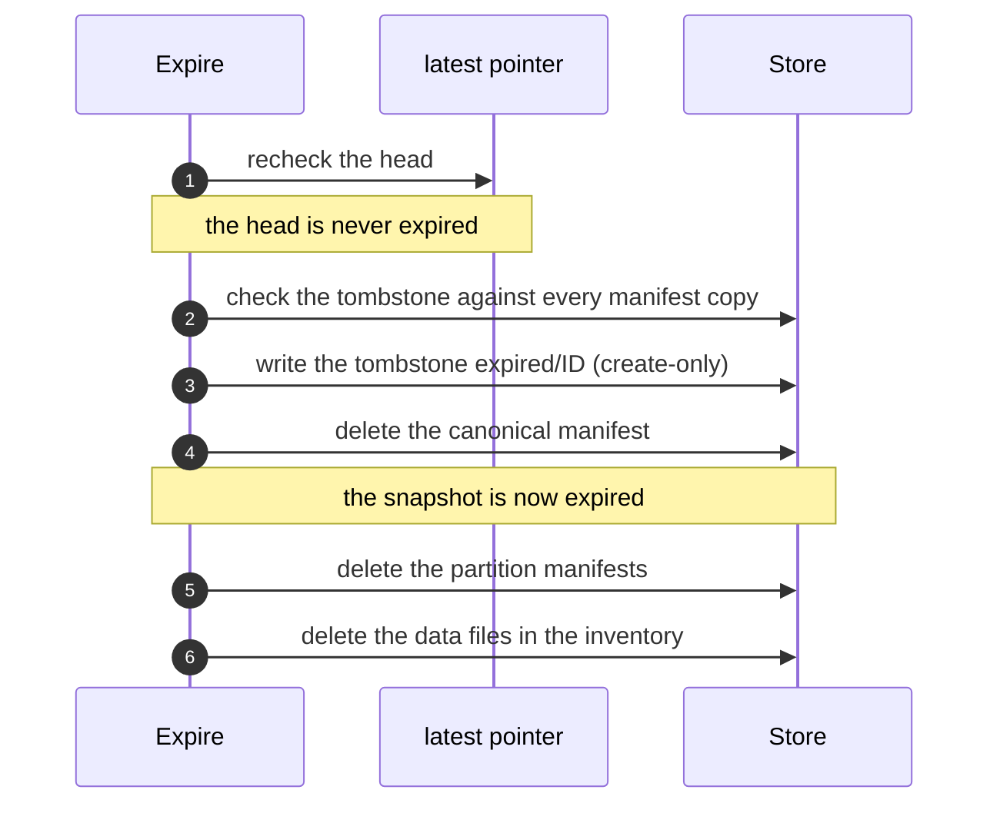

# Expiring Snapshots and Reclaiming Residual Data

This guide explains how to remove obsolete data from a Lode dataset with
`Dataset.Expire` and `Dataset.Sweep`, how Lode performs each operation, and
why it does so. The guide is explanatory. The normative rules are defined in
[`CONTRACT_RETENTION.md`](../contracts/CONTRACT_RETENTION.md), which
prevails wherever the two documents differ.

## The Two Operations

| | `Expire` | `Sweep` |
|---|---|---|
| Removes | Selected snapshots, with their manifests and data | Residual data: the remainder of interrupted expiries, and the data of writes that never committed |
| The caller specifies | Which snapshots to remove (`IDs`, `Partition`, `Before`) | The minimum age at which an uncommitted write is reclaimed (`Grace`) |
| Typical frequency | Whenever the retention policy designates data as obsolete | Periodically, for example daily |

Both operations accept a `DryRun` flag, which reports exactly what a real
run would do without modifying anything. Each operation always returns a
report that describes the work completed, including when it also returns an
error.

Lode never initiates removal: no background process runs, and nothing is
removed unless the caller invokes one of these operations. The retention
policy belongs to the caller, and Lode provides a safe primitive for
applying it.

## The Life Cycle of an Expired Snapshot



- **Live**: the snapshot has its manifests and data, and no tombstone.
- **Expiring**: a tombstone exists, and the canonical manifest remains. The
  snapshot is fully readable. Its expiry has been decided but not yet
  performed.
- **Expired**: the canonical manifest has been deleted. `Snapshot` and
  `Read` return `ErrSnapshotExpired`, which also matches `ErrNotFound`, so a
  caller can distinguish a deliberately removed snapshot from one that never
  existed.
- **Settled**: every manifest and data object has been deleted, and only
  the tombstone remains, permanently.

A snapshot written before canonical manifests were introduced (in older
Hive datasets) has no canonical manifest, so its tombstone alone renders it
expired.

## What a Tombstone Records

A tombstone is a small object at `<dataset>/expired/<snapshot ID>`, written
**before anything is deleted**. It records:

- the snapshot ID,
- when the expiry was requested,
- the manifest's `CreatedAt`, and
- the snapshot's inventory: every data file's path and size, copied from
  the manifest.

Writing the tombstone makes the expiry irrevocable: once the tombstone
exists, the expiry is completed by the same run, by the next `Expire` that
names the ID, or by `Sweep`. The tombstone is what makes expiry
**resumable**. Without it, a failure between deletions would leave data that
no manifest describes and no record explains. With it, every later step
operates on the inventory that the tombstone contains, never on manifests
that may already have been deleted. The recorded sizes also allow a resumed
run to report `Bytes`.

Tombstones are never removed. Lode records an expiry by creating a new
object, never by modifying an existing one. Retention thereby preserves
Lode's rule that committed state is never rewritten.

A tombstone governs only a manifest that it **describes**, that is, one with
the same `CreatedAt` and the same file list. A tombstone that cannot be read,
or that contradicts a manifest still present, is reported
(`SweepReport.Unparseable` or an `Expire` error) and is never acted upon.
Lode never rewrites or removes a tombstone to recover. An operator is
responsible for resolving the corruption.

## How `Expire` Removes a Snapshot



Every step is idempotent: a step that finds its target already deleted
succeeds. If the process terminates at any point, the next `Expire` that
names the same ID, or the next `Sweep`, resumes from the tombstone.

### Selecting Snapshots

- `IDs` selects the named snapshots, including any whose expiry an earlier
  run began but did not complete.
- `Partition` selects snapshots that have a manifest in the given partition
  or beneath it (Hive layouts only). Matching compares whole path segments,
  so `run_id=run-1` never selects `run_id=run-10`. A snapshot with files
  outside the partition is retained and reported in `Mixed`. To expire such
  a snapshot, name it in `IDs` in a request that omits `Partition`. Because
  the fields intersect, a request that specifies both still reports it as
  mixed.
- `Before` selects snapshots whose write began before the given instant.
  The instant is derived from the snapshot ID, so selection loads no
  manifest.

The fields combine by intersection. A request that specifies none of them
is rejected with `ErrInvalidArgument`.

### The Head Is Never Expired

The snapshot that the `latest` pointer names is retained and reported in
`RetainedHead`, even when the selection includes it. Selecting the head is
not an error, so a `Before` request on a dataset without newer writes still
succeeds. Repeating the request after a newer commit removes what was
retained.

Only the pointer identifies the head. Retention never infers the head from
snapshot IDs, because a clock that has been set back can assign the most
recent commit the smaller ID. `Expire` therefore returns
`ErrHeadUncommitted` in two cases:

- The pointer names a snapshot whose manifest has not been persisted, which
  is a pending commit ([CONTRACT_CORE §Head
  Pointer](../contracts/CONTRACT_CORE.md#head-pointer)). Retry once the
  commit completes. If `Expire` detects this condition before the run
  begins, nothing is expired. If it detects the condition at the check that
  precedes a later snapshot, the snapshots already expired remain expired,
  and the report lists them. A pointer left by an abandoned commit remains until the next
  commit replaces it: `Latest` never replaces a pointer, because no
  persisted state distinguishes an abandoned commit from a pending one.
- The dataset has snapshots or tombstones but no pointer (because it was
  written before the pointer was introduced). Nothing is expired. Any
  commit creates the pointer, after which retention proceeds.

A pointer that does not contain a snapshot ID that Lode could have
generated is treated as corrupt, and retention fails rather than rely on
it.

## How `Sweep` Reclaims Residual Data

`Sweep` performs two tasks in a single run.

**It completes interrupted expiries.** For each tombstone whose snapshot
still has manifests or data, `Sweep` verifies the tombstone against every
manifest copy, deletes the manifests, and then reclaims the data. The grace
period does not apply, because the tombstone already records the decision.
`Sweep` instead holds three kinds of tombstone and retains their data:

- a tombstone that names the committed head, which is misplaced, because
  Lode never creates one
- every tombstone while a commit is pending, because the head is then
  undetermined
- a tombstone that is invalid or contradicts a manifest copy, which is
  reported in `Unparseable`

**It reclaims orphaned data.** A data object whose snapshot has neither a
manifest nor a tombstone, and which is older than `Grace`, belongs to a
write that never committed (an aborted stream or a terminated process) and
is deleted.


`Sweep` does not rely on a listing to establish that a manifest is absent.
Before it completes an expiry for a snapshot of which the listing shows any
object, or reclaims an orphaned object, it queries the manifest paths
directly, because a store's listing can lag behind its writes. A
tombstoned snapshot of which the listing shows nothing is not examined in
that run. A later run whose listing shows the residual objects processes
them.

Reclamation operates per snapshot, not per file. Every object under a live
snapshot's data prefix is retained, whether or not its manifest lists the
object, and every object under a settled snapshot's prefix is deleted.
Apart from the manifests of the snapshots it settles, `Sweep` modifies
nothing outside the layout's data paths: auxiliary files such as
`partitions/<k=v>/run.json` remain the caller's responsibility, and the
pointer and tombstones are never deleted.

### Choosing a Grace Period

`Grace` has no default and must be positive. A write in progress has data
objects but no manifest, so `Sweep` cannot distinguish it from an aborted
write. Only age differentiates them. Age is measured from the instant in
the snapshot ID, which is taken from the **writer's** clock. Choose a grace
period that exceeds the sum of:

- the duration of the longest expected write, and
- the largest clock difference between any writing host and the host that
  runs `Sweep` (whether from skew or from a clock that has been set back).

Twenty-four hours is a conservative initial value.

## A Typical Schedule

A crawler that writes each run into a Hive dataset partitioned by `run_id`,
and that retains raw runs only until they are imported, might proceed as
follows:

<!-- illustrative -->
```go
// Once a run is imported downstream, expire its raw snapshots.
preview, err := ds.Expire(ctx, lode.ExpireRequest{Partition: "run_id=" + runID, DryRun: true})
// ... inspect preview.Expired, preview.Mixed, preview.Bytes ...
report, err := ds.Expire(ctx, lode.ExpireRequest{Partition: "run_id=" + runID})

// Separately, on a daily timer:
swept, err := ds.Sweep(ctx, lode.SweepRequest{Grace: 24 * time.Hour})
```

The runnable version is [`examples/retention`](../../examples/retention).

## Interpreting the Reports

| Field | Meaning |
|---|---|
| `ExpireReport.Expired` | Snapshots expired (or, on a dry run, those that would be expired) |
| `ExpireReport.Mixed` | Snapshots retained because they have files outside `Partition` |
| `ExpireReport.RetainedHead` | The head, if the selection included it |
| `ExpireReport.Skipped` | Inventory paths that are not data objects of the snapshot, which are left in place |
| `SweepReport.Settled` | Interrupted expiries whose remaining manifests this run found and removed. An expiry whose manifests were already deleted has its data reclaimed without appearing here. |
| `SweepReport.Orphans` | Objects of writes that never committed |
| `SweepReport.Unparseable` | Tombstones that Lode cannot rely on, and objects whose ID contains no instant. Nothing listed here is deleted. |
| `Objects`, `Bytes`, `Unsized` | The objects deleted, as the run's listing reported them. Sizes are taken from tombstone inventories, and objects without a recorded size are counted in `Unsized`. |

The counts are only as exact as the store's listing. Concurrent runs can
both count the same object, and an object that a lagging listing omitted is
deleted without being counted.

## Known Limitations

- **A late partition manifest.** On a Hive layout, a commit can still be
  writing its partition manifests when a later commit advances the head and
  an `Expire` removes the first commit's snapshot. The slower writer can
  then add a partition manifest after the expiry, and `ListManifests` and
  `ListPartitions` may report it until the next `Sweep` or `Expire` removes
  it. Leaving a margin in `Before` avoids this situation.
- **Snapshot ID collisions.** IDs are unique except in the event of a 64-bit
  random collision within a single nanosecond (see [Snapshot
  IDs](snapshot-ids.md)). Should a collision occur, retention declines to
  act on the older tombstone unless the new manifest has the same commit
  time and files. However, data that the new write stages before its
  manifest exists could be reclaimed.

## Errors

| Error | Meaning | Remedy |
|---|---|---|
| `ErrHeadUncommitted` | `Expire`: a commit is pending. Both operations: the dataset has snapshots or tombstones but no pointer. (`Sweep` succeeds while a commit is pending but completes no expiry in that run.) | Retry, or, for a dataset written before the pointer was introduced, perform one commit |
| `ErrSnapshotExpired` | The requested snapshot has been expired (the error also matches `ErrNotFound`) | None, because this is the expected result after expiry |
| `ErrInvalidArgument` | An `ExpireRequest` without a selector, or a `Grace` that is not positive | Correct the request |
| `ErrInvalidPath` | `Partition` is not a canonical relative partition path | Correct the partition path |
| `ErrPartitionPrefixNotSupported` | `Partition` was specified on a layout without partitions | Select by `IDs` or `Before` |
