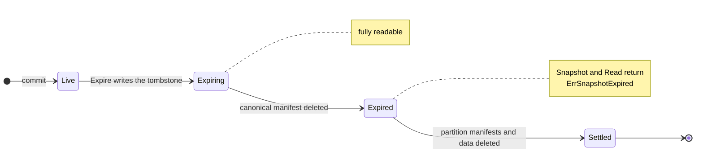
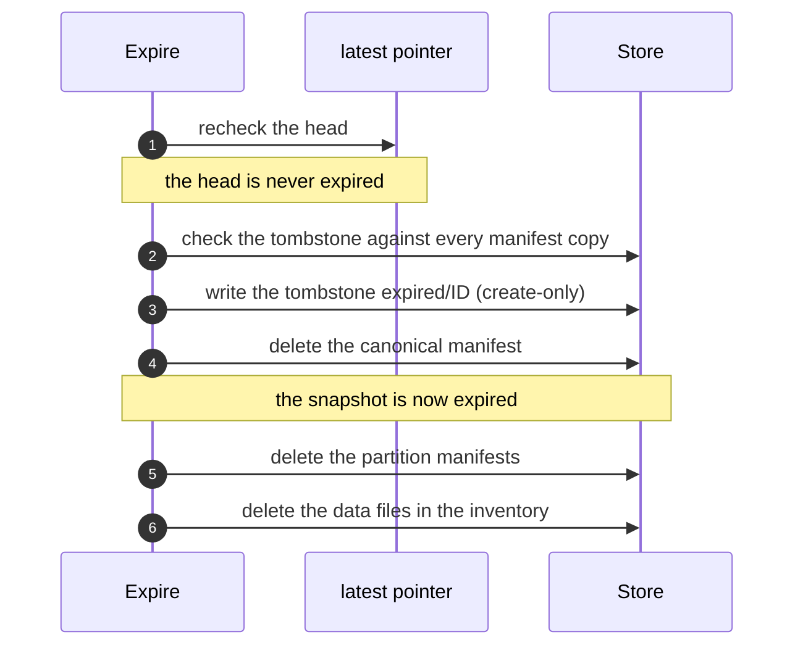

# Expiring Snapshots and Reclaiming Residual Data

This guide explains how to remove obsolete data from a Lode dataset with
`Dataset.Expire` and `Dataset.Sweep`, how Lode performs each operation, and
why it does so. The guide is explanatory.
[`CONTRACT_RETENTION.md`](../contracts/CONTRACT_RETENTION.md) defines the
normative rules and prevails wherever the two documents differ.

## The Two Operations

| | `Expire` | `Sweep` |
|---|---|---|
| Removes | Selected snapshots, with their manifests and data | Residual data: the remainder of interrupted expiries, and the data of writes that never committed |
| The caller specifies | Which snapshots to remove (`IDs`, `Partition`, `Before`) | The minimum age at which an uncommitted write is reclaimed (`Grace`) |
| Typical frequency | Whenever the retention policy designates data as obsolete | Periodically, for example daily |

Both operations accept a `DryRun` flag. With the flag set, an operation
reports exactly what a real run would do and modifies nothing. Each
operation always returns a report of the work completed, even when it also
returns an error.

Lode never initiates removal: no background process runs, and Lode removes
nothing unless the caller invokes one of these operations. The retention
policy belongs to the caller, and Lode provides a safe primitive for
applying it.

## The Life Cycle of an Expired Snapshot



- **Live**: the snapshot has its manifests and data, and no tombstone.
- **Expiring**: a tombstone exists, and the canonical manifest remains. The
  snapshot is fully readable. The tombstone records the decision to expire
  the snapshot, but Lode has not yet performed the expiry.
- **Expired**: Lode has deleted the canonical manifest. `Snapshot` and
  `Read` return `ErrSnapshotExpired`, which also matches `ErrNotFound`, so a
  caller can distinguish a deliberately removed snapshot from one that never
  existed.
- **Settled**: Lode has deleted every manifest and data object, and only
  the tombstone remains, permanently.

A snapshot in an older Hive dataset that predates canonical manifests has
no canonical manifest, so its tombstone alone renders it expired.

## Tombstone Contents

A tombstone is a small object at `<dataset>/expired/<snapshot ID>` that
`Expire` writes **before it deletes any object**. The tombstone records:

- the snapshot ID,
- the time of the expiry request,
- the manifest's `CreatedAt`, and
- the snapshot's inventory: every data file's path and size, copied from
  the manifest.

Writing the tombstone makes the expiry irrevocable: once the tombstone
exists, the same run, the next `Expire` that names the ID, or `Sweep`
completes the expiry. The tombstone makes expiry **resumable**. Without it, a failure between deletions would leave data that
no manifest describes and no record explains. With it, every later step
operates on the inventory that the tombstone contains, never on manifests
that an earlier step may already have deleted. The recorded sizes also allow a resumed
run to report `Bytes`.

Lode never removes a tombstone. It records an expiry by creating a new
object, never by modifying an existing one. Retention thereby preserves
Lode's rule that no operation rewrites committed state.

A tombstone governs only a manifest that it **describes**, that is, one with
the same `CreatedAt` and the same file list. Lode reports a tombstone that
it cannot read, or that contradicts a manifest still present
(`SweepReport.Unparseable` or an `Expire` error), and never acts on it.
Recovery from the fault never rewrites or removes such a tombstone, and an
operator resolves the corruption.

## Snapshot Removal by `Expire`



Every step is idempotent: a step that finds its target already deleted
succeeds. If the process terminates at any point, the next `Expire` that
names the same ID, or the next `Sweep`, resumes from the tombstone.

### Selecting Snapshots

- `IDs` selects the named snapshots, including any whose expiry an earlier
  run began but did not complete.
- `Partition` selects snapshots that have a manifest in the given partition
  or beneath it (Hive layouts only). Matching compares whole path segments,
  so `run_id=run-1` never selects `run_id=run-10`. `Expire` retains a
  snapshot with files outside the partition and reports it in `Mixed`. To
  expire such a snapshot, name it in `IDs` in a request that omits
  `Partition`. Because the fields combine by intersection, `Expire` still
  reports the snapshot as mixed when a request specifies both.
- `Before` selects snapshots whose write began before the given instant.
  Lode derives the instant from the snapshot ID, so selection loads no
  manifest.

The fields combine by intersection. `Expire` returns `ErrInvalidArgument`
for a request that specifies none of them.

### Head Retention

`Expire` retains the snapshot that the `latest` pointer names and reports it
in `RetainedHead`, even when the selection includes it. Selecting the head is
not an error, so a `Before` request on a dataset without newer writes still
succeeds. Repeating the request after a newer commit removes the formerly
retained head.

Only the pointer identifies the head. Retention never infers the head from
snapshot IDs, because a clock that jumps backward can assign the most
recent commit the smaller ID. `Expire` therefore returns
`ErrHeadUncommitted` in two cases:

- The pointer names a snapshot without a persisted manifest, which
  indicates a pending commit ([CONTRACT_CORE §Head
  Pointer](../contracts/CONTRACT_CORE.md#head-pointer)). Retry once the
  commit completes. If `Expire` detects this condition before the run
  begins, it expires nothing. If it detects the condition partway through
  the run, the snapshots already expired remain expired, and the report
  lists them. A pointer left by an abandoned commit remains
  until the next commit replaces it: `Latest` never replaces a pointer, because no
  persisted state distinguishes an abandoned commit from a pending one.
- The dataset has snapshots or tombstones but no pointer, because its
  snapshots predate the pointer. `Expire` expires nothing. Any commit
  creates the pointer, after which retention proceeds.

Retention treats a pointer as corrupt when the pointer does not contain a
snapshot ID that Lode could have generated, and retention then fails rather
than rely on the pointer.

## Residual Data Reclamation by `Sweep`

`Sweep` performs two tasks in a single run.

**It completes interrupted expiries.** For each tombstone whose snapshot
still has manifests or data, `Sweep` verifies the tombstone against every
manifest copy, deletes the manifests, and then reclaims the data. The grace
period does not apply, because the tombstone already records the decision.
`Sweep` excludes three kinds of tombstone from this step and retains their
data:

- a misplaced tombstone that names the committed head, because Lode never
  writes a tombstone for the head
- every tombstone while a commit is pending, because the head is then
  undetermined
- a tombstone that is invalid or contradicts a manifest copy, because Lode
  cannot rely on it, and which `Sweep` reports in `Unparseable`

**It reclaims orphaned data.** `Sweep` deletes every data object that is
older than `Grace` and whose snapshot has neither a manifest nor a
tombstone. Such an object belongs to a write that never committed, such as
a write from an aborted stream or a terminated process.


`Sweep` does not rely on a listing to establish that a manifest is absent.
A store's listing can lag behind its writes. Before `Sweep` completes an
expiry for a listed snapshot or reclaims an orphaned object, it therefore
queries the manifest paths directly. In each run, `Sweep` skips any
tombstoned snapshot that is absent from the listing. A later run whose listing shows the residual objects processes
them.

Reclamation operates per snapshot, not per file. `Sweep` retains every
object under a live snapshot's data prefix, whether or not its manifest
lists the object, and deletes every object under a settled snapshot's
prefix.
Apart from the manifests of the snapshots it settles, `Sweep` modifies
nothing outside the layout's data paths: auxiliary files such as
`partitions/<k=v>/run.json` remain the caller's responsibility, and `Sweep`
never deletes the pointer or a tombstone.

### Choosing a Grace Period

`Grace` has no default and must be positive. A write in progress has data
objects but no manifest, so `Sweep` cannot distinguish it from an aborted
write. Only age differentiates them. `Sweep` measures age from the instant
in the snapshot ID, and the **writer's** clock supplies that instant. Choose a grace
period that exceeds the sum of:

- the duration of the longest expected write, and
- the largest clock difference between any writing host and the host that
  runs `Sweep` (whether from skew or from a clock that has been set back).

Twenty-four hours is a conservative initial value.

## A Typical Schedule

Consider a crawler that writes each run into a Hive dataset partitioned by
`run_id` and retains each raw run until a downstream system imports it. The
crawler schedules retention as follows:

<!-- illustrative -->
```go
// Once a run is imported downstream, expire its raw snapshots.
preview, err := ds.Expire(ctx, lode.ExpireRequest{Partition: "run_id=" + runID, DryRun: true})
// ... inspect preview.Expired, preview.Mixed, preview.Bytes ...
report, err := ds.Expire(ctx, lode.ExpireRequest{Partition: "run_id=" + runID})

// Separately, on a daily timer:
swept, err := ds.Sweep(ctx, lode.SweepRequest{Grace: 24 * time.Hour})
```

The runnable version is [`examples/retention`](../../examples/retention).

## Interpreting the Reports

| Field | Meaning |
|---|---|
| `ExpireReport.Expired` | Snapshots expired (or, on a dry run, those that would be expired) |
| `ExpireReport.Mixed` | Snapshots retained because they have files outside `Partition` |
| `ExpireReport.RetainedHead` | The head, if the selection included it |
| `ExpireReport.Skipped` | Inventory paths that are not data objects of the snapshot, which `Expire` leaves in place |
| `SweepReport.Settled` | Interrupted expiries whose remaining manifests this run found and removed. When an earlier run has already deleted an expiry's manifests, this run reclaims the expiry's data but omits the expiry from this list. |
| `SweepReport.Orphans` | Objects of writes that never committed |
| `SweepReport.Unparseable` | Tombstones that Lode cannot trust, and objects whose ID contains no instant. Lode deletes nothing listed here. |
| `Objects`, `Bytes`, `Unsized` | The objects deleted, as the run's listing reported them. Lode takes sizes from tombstone inventories and counts objects without a recorded size in `Unsized`. |

The counts are only as exact as the store's listing. Concurrent runs can
both count the same object, and a run deletes but does not count an object
that a lagging listing omitted.

## Known Limitations

- **A late partition manifest.** On a Hive layout, a commit can still be
  writing its partition manifests when a later commit advances the head and
  an `Expire` removes the first commit's snapshot. The slower writer can
  then add a partition manifest after the expiry, and `ListManifests` and
  `ListPartitions` may report it until the next `Sweep` or `Expire` removes
  it. Leaving a margin in `Before` avoids this situation.
- **Snapshot ID collisions.** IDs are unique except in the event of a 64-bit
  random collision within a single nanosecond (see [Snapshot
  IDs](snapshot-ids.md)). Should a collision occur, retention declines to
  act on the older tombstone unless the new manifest has the same commit
  time and files. However, `Sweep` could reclaim data that the new write
  stages before its manifest exists.

## Errors

| Error | Meaning | Remedy |
|---|---|---|
| `ErrHeadUncommitted` | `Expire`: a commit is pending. Both operations: the dataset has snapshots or tombstones but no pointer. (`Sweep` succeeds while a commit is pending but completes no expiry in that run.) | Retry, or, for a dataset written before the pointer was introduced, perform one commit |
| `ErrSnapshotExpired` | The requested snapshot has been expired (the error also matches `ErrNotFound`) | None, because this is the expected result after expiry |
| `ErrInvalidArgument` | An `ExpireRequest` without a selector, or a `Grace` that is not positive | Correct the request |
| `ErrInvalidPath` | `Partition` is not a canonical relative partition path | Correct the partition path |
| `ErrPartitionPrefixNotSupported` | `Partition` was specified on a layout without partitions | Select by `IDs` or `Before` |
