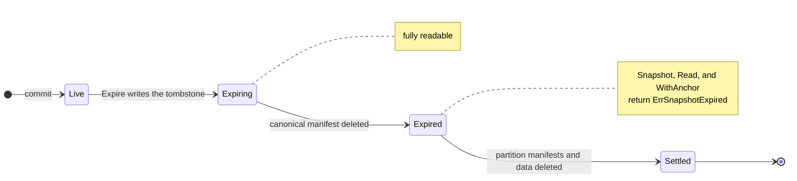
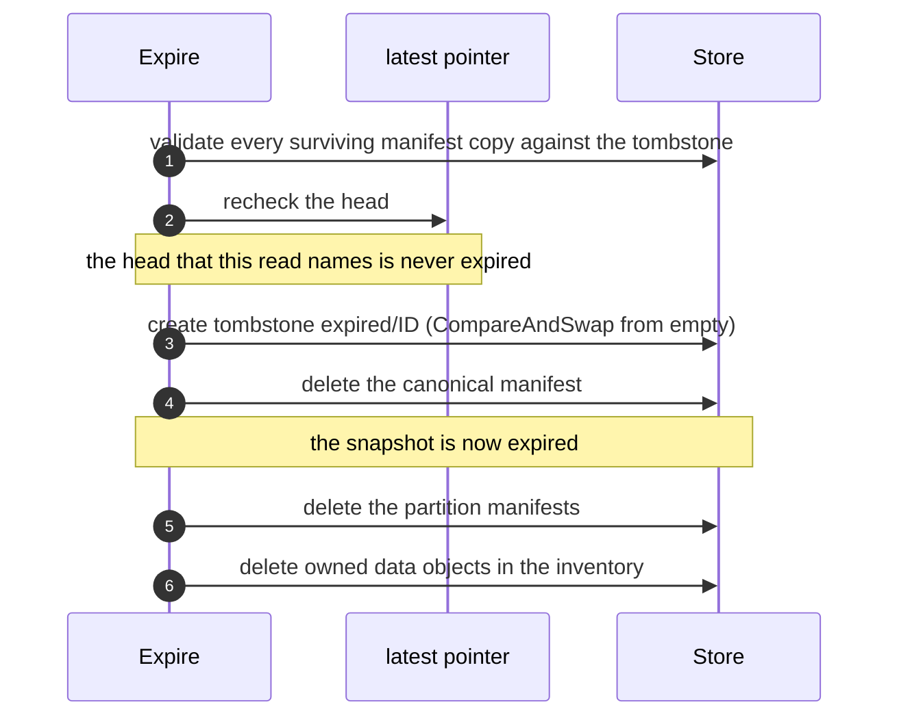
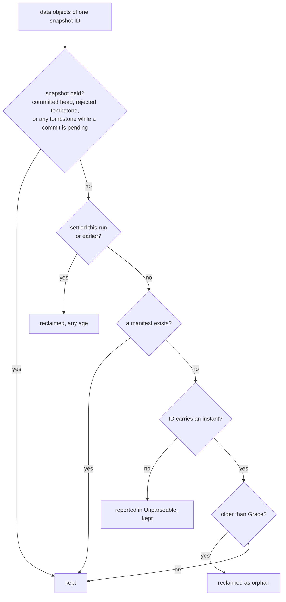

# Expiring Snapshots and Reclaiming Residual Data

This guide explains how to remove obsolete data from a Lode dataset with
`Expire` and `Sweep` on writer handles (`*Records[T]` and `*Blobs`), how to
remove an entire dataset with `Root.RemoveDataset`, and why each step works
as it does. The guide is explanatory;
[`CONTRACT_RETENTION.md`](../contracts/CONTRACT_RETENTION.md) and
[`CONTRACT_WRITE_API.md`](../contracts/CONTRACT_WRITE_API.md) define the
normative rules.

## The Operations

| | `Expire` | `Sweep` | `Root.RemoveDataset` |
|---|---|---|---|
| Scope | Selected historical snapshots (the head that it observes is kept; see Head Retention) | Interrupted expiries, missing Hive partition manifests, and uncommitted orphans older than `Grace` | Whole dataset, including its head snapshot |
| Caller specifies | `IDs`, `Partition`, and/or `Before` (plus optional `DryRun`) | Positive `Grace` duration (plus optional `DryRun`) | `DatasetID` (plus optional `WithRetry*`) |
| Typical frequency | When retention policy marks runs or time windows obsolete | Periodically (for example, daily) | When retiring a dataset permanently |

Both `Expire` and `Sweep` always return a non-nil report (`*ExpireReport`,
`*SweepReport`), even when returning an error, so callers can inspect all
work completed prior to any failure.

Lode never runs background deletion: retention policy and scheduling belong
entirely to the caller.

## The Life Cycle of an Expired Snapshot



- **Live**: manifests and data objects exist, and no tombstone exists.
- **Expiring**: a tombstone exists and the canonical manifest still exists;
  the snapshot remains readable.
- **Expired**: the canonical manifest has been deleted. `Snapshot`, `Read`,
  and `WithAnchor` return `ErrSnapshotExpired`, which also matches
  `ErrNotFound`.
- **Settled**: all canonical and partition manifests and all owned data
  objects are deleted; only the permanent tombstone remains.

## Tombstone Contents

A tombstone is a create-only JSON object at `<dataset dir>/expired/<snapshot_id>`
written **before any manifest or data object is deleted**. It records:
- `snapshot_id`,
- `requested_at`,
- `manifest_created_at`, and
- `objects` (the path and byte size of every data object in the snapshot's
  `Manifest.Objects`, while also decoding legacy `"files"` tombstones).

Because the tombstone outlives the manifests, an interrupted expiry can
always be resumed by `Sweep` or a repeated `Expire` naming the ID without
losing track of which data objects belonged to the snapshot or what their
byte sizes were.

## Snapshot Removal by `Expire`



### Selecting Snapshots

- `IDs` selects the named `SnapshotID` values, including snapshots whose
  expiry an earlier run recorded in a tombstone without finishing.
- `Partition` selects snapshots that have a partition manifest in that
  partition or beneath it on Hive datasets. Matching compares whole path
  segments (`run_id=run-1` never selects `run_id=run-10`). Snapshots that
  also own data objects outside `Partition` are kept and reported in
  `ExpireReport.Mixed`.
- `Before` selects snapshots whose write began strictly before the given
  instant, read directly from the `SnapshotID` prefix without loading
  manifests.

Set fields combine by intersection; leaving all three unset returns
`ErrInvalidArgument`.

### Head Retention

`Expire` never deletes a head snapshot that one of its reads of `latest`
names. A live run reads `latest` again for each candidate that it is about to
write for, but the read and the deletion are not atomic. When the selection includes the
head, `Expire` retains it and records its ID in
`ExpireReport.RetainedHead`. If `latest` names a pending commit without a
persisted manifest, or is absent alongside existing snapshots or tombstones,
`Expire` returns `ErrHeadUncommitted`.

## Residual Reclamation and Partition Reindexing by `Sweep`

`Sweep` performs three tasks in one run:

1. **Completes interrupted expiries** (`Settled`): verifies valid tombstones,
   deletes any remaining canonical and partition manifests, and deletes their
   data objects regardless of `Grace` (holding back any snapshot protected by
   `latest` or carrying an invalid/contradicted tombstone, which is reported
   in `Unparseable`).
2. **Reclaims orphaned data** (`Orphans`): deletes data objects older than
   `Grace` whose snapshot ID has neither a manifest nor a tombstone (such as
   objects from aborted streams or crashed writers).
3. **Repairs Hive partition indexes** (`Reindexed`): for live committed Hive
   snapshots older than `Grace` whose canonical manifest is present without
   one or more partition manifest copies, copies the canonical manifest to
   each missing partition path.



### Choosing a Grace Period

`Grace` has no default and must be positive (`ErrInvalidArgument` otherwise).
It must exceed the sum of the longest expected write duration and the maximum
clock skew between any writing host and the host running `Sweep`. Twenty-four
hours is a conservative starting point.

## Typical Schedule

<!-- illustrative -->
```go
// Once a run is imported downstream, preview and expire its raw snapshots.
preview, err := ds.Expire(ctx, lode.ExpireRequest{Partition: "run_id=" + runID, DryRun: true})
// ... inspect preview.Expired, preview.Mixed, preview.Bytes ...
report, err := ds.Expire(ctx, lode.ExpireRequest{Partition: "run_id=" + runID})

// Separately, on a daily timer:
swept, err := ds.Sweep(ctx, lode.SweepRequest{Grace: 24 * time.Hour})
```

The runnable example is [`examples/retention`](../../examples/retention). To
retire an entire dataset (including its head snapshot), call
`root.RemoveDataset(ctx, "crawls")`, after which opens, reads, and commits on
that dataset return `lode.ErrRemoved`.

## Errors

| Error | Meaning | Remedy |
|---|---|---|
| `ErrHeadUncommitted` | `Expire`: a commit is pending. Both: the dataset has snapshots or tombstones without a `latest` pointer. | Retry after the commit finishes, or perform one commit on a pre-pointer dataset |
| `ErrSnapshotExpired` | The requested snapshot was expired (also matches `ErrNotFound`) | Expected outcome after expiry |
| `ErrRemoved` | The dataset was permanently removed via `Root.RemoveDataset` | Expected outcome after dataset removal |
| `ErrInvalidArgument` | Empty `ExpireRequest` selectors, or `Grace <= 0` | Supply valid request fields |
| `ErrInvalidPath` | `Partition` is not a canonical relative partition path | Fix the partition path |
| `ErrNotPartitioned` | `Partition` was set on an unpartitioned dataset | Select by `IDs` or `Before` |
