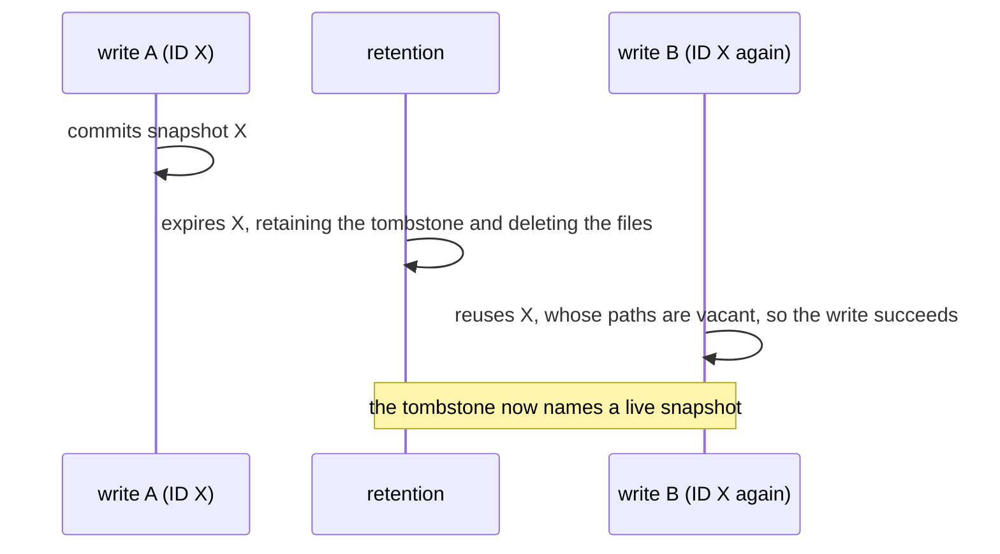

# Snapshot IDs

This guide describes the structure of a Lode snapshot ID, how IDs are
ordered, and why their uniqueness matters once retention is in use. The
guide is explanatory, and the normative rules are defined in
[`CONTRACT_CORE.md`](../contracts/CONTRACT_CORE.md) §Snapshot ID.

## The Format

Lode generates every snapshot ID, and the caller never chooses one. Since
v0.11.0 an ID has the following form:

```
1792501720835376648-f10ae1647eb0ef59
└───────┬─────────┘ └──────┬───────┘
     instant             nonce
```

- **Instant**: the Unix time, in nanoseconds, at which the write began,
  expressed in decimal.
- **Nonce**: sixteen lowercase hexadecimal digits from a cryptographically
  secure random source.

IDs written before v0.11.0 consist of the instant alone
(`1792501720835376648`). They remain valid everywhere: reads, selection,
and retention treat both forms identically.

## Using IDs

IDs are opaque strings. Supply them to `Snapshot`, `Read`, and
`ExpireRequest.IDs` exactly as Lode returned them, and do not parse them as
numbers, since an ID in the current form is not a number.

The instant nevertheless remains legible, which allows
`ExpireRequest.Before` to select snapshots from a listing without loading
any manifest.

## How IDs Are Ordered

Compared as strings, IDs are ordered by instant, because the instant has a
fixed length of nineteen digits from 2001-09-09 01:46:40 UTC until 64-bit
nanosecond time is exhausted in April 2262. An ID generated by a clock set
before 2001-09-09 01:46:40 UTC has a shorter instant and sorts out of
chronological order. A legacy, instant-only ID sorts before every current ID
with the same instant.

Two writes that begin in the same nanosecond are ordered by their nonces,
which are random and therefore do not indicate which write committed first.
This matters only where Lode assumes that the largest ID is the most recent.
`Latest` makes that assumption when the `latest` pointer is missing or names
a snapshot without a manifest (after an abandoned commit or a manual edit).
Parent resolution makes it only when the pointer is missing or does not
contain a snapshot ID. Retention never makes the assumption and declines to
run without a pointer it can rely on.

## Why IDs Must Never Repeat

Before retention existed, a repeated ID was detected immediately: the second
write encountered the first write's manifest and failed with
`ErrPathExists`. Retention changes this, because an expiry deletes those
files but leaves a permanent tombstone at `expired/<id>`:



A tombstone declares that everything under its ID is being removed, so a
later snapshot that reused the ID could be mistaken for the expired one. An
ID derived from the clock alone repeats whenever the clock repeats an
instant. A clock repeats an instant when it is coarse, when two hosts write
in the same nanosecond, after an NTP adjustment, and when an operator
restores a virtual machine from a snapshot. The nonce removes this dependence on the clock.

## Collisions

Two IDs coincide only when two writes begin in the same nanosecond **and**
draw the same 64-bit nonce, a probability of 1 in 2⁶⁴ for each such pair.
Lode does not reserve IDs against existing ones, so if a collision occurs,
the consequences are as follows:

- **While the earlier snapshot exists**, the colliding write fails at the
  first path that both writes share. If that path is a data file, the write
  fails with `ErrPathExists` during staging, before it modifies the pointer.
  If the data paths differ (because the writes target different
  partitions), the write instead fails at its create-only manifest write,
  after it has already advanced the `latest` pointer (Lode writes the
  pointer before the manifest). The pointer can then continue to name the
  earlier snapshot until the next commit.
- **After the earlier snapshot has expired**, its tombstone records that
  snapshot's commit time and file list, and retention acts on a tombstone
  only with respect to a manifest that the tombstone describes. While the
  new snapshot is the head, it is retained like any head. Once it has been
  superseded, an `Expire` that names the ID returns an error, and `Sweep`
  reports the tombstone in `Unparseable` and retains the data. The exception
  is the case in which both commits also completed in the same nanosecond
  with the same files: the old tombstone then describes the new snapshot,
  which can therefore be removed. The new write is also exposed while it
  stages data, before its manifest exists. Nothing yet distinguishes that
  data from the expired snapshot's residual objects, so a `Sweep`, or an
  `Expire` that names the ID, can delete it.

Instant-only IDs collided whenever two writes began in the same nanosecond,
with the same consequences. The nonce reduces such a collision to a 2⁻⁶⁴
event.
