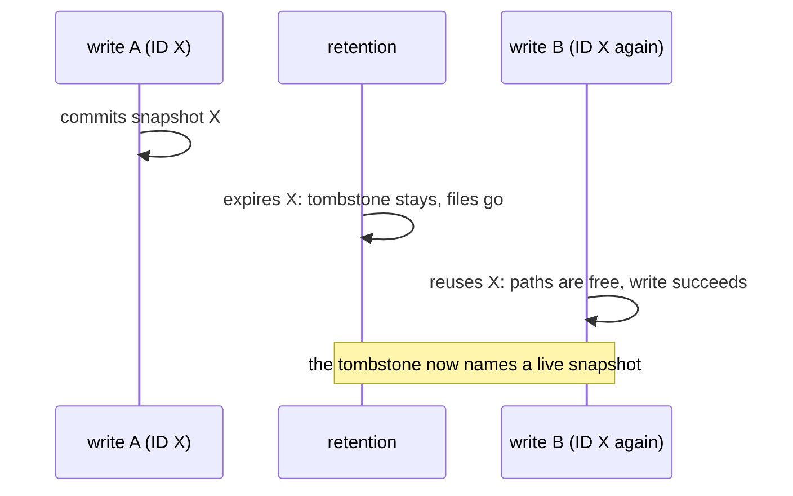

# Snapshot IDs

This guide explains what a Lode snapshot ID looks like, how IDs order, and
why their uniqueness matters once retention exists. It is explanatory; the
rules live in [`CONTRACT_CORE.md`](../contracts/CONTRACT_CORE.md)
§Snapshot ID.

## The format

Lode generates every snapshot ID; you never choose one. From v0.11.0 an ID
looks like this:

```
1792501720835376648-f10ae1647eb0ef59
└───────┬─────────┘ └──────┬───────┘
     instant             nonce
```

- **instant**: the Unix time in nanoseconds when the write began, in
  decimal.
- **nonce**: 16 lowercase hex digits from a cryptographically secure random
  source.

IDs written before v0.11.0 are the instant alone (`1792501720835376648`).
They stay valid everywhere: reads, selection and retention treat both forms
the same.

## Using IDs

IDs are opaque strings. Pass them back to `Snapshot`, `Read` and
`ExpireRequest.IDs` exactly as Lode returned them, and do not parse them as
numbers: an ID in the new form is not one.

The instant is still readable, which is how `ExpireRequest.Before` selects
snapshots from a listing without loading any manifest.

## How IDs order

Compared as strings, IDs order by instant: the instant has a fixed 19
digits from 2001-09-09 01:46:40 UTC until 64-bit nanoseconds run out in
April 2262. An old instant-only ID sorts before every new ID with the same
instant.

Two writes that begin in the same nanosecond order by their nonce, which is
random and says nothing about which committed first. That matters only
where Lode falls back to "the largest ID is the newest": `Latest` and
parent resolution do so when the `latest` pointer is missing or names a
snapshot with no manifest (after a crash or a hand edit). Retention never
does; it refuses to run without a pointer it can trust.

## Why IDs must never repeat

Before retention, a repeated ID was caught on the spot: the second write
found the first one's manifest and failed with `ErrPathExists`. Retention
changes that, because expiry deletes those files but leaves a permanent
tombstone at `expired/<id>`:



A tombstone says "everything under this ID is being removed", so a later
snapshot that reused the ID could be mistaken for the expired one. A
clock-only ID repeats whenever the clock repeats an instant: a coarse
clock, two hosts in the same nanosecond, an NTP step, or a VM restored from
a snapshot. The nonce takes the clock out of it.

## What if two IDs collide anyway

Two IDs coincide only when two writes begin in the same nanosecond **and**
draw the same 64-bit nonce, a 1 in 2⁶⁴ chance for each such pair. Lode does
not reserve IDs against existing ones, so should it happen:

- **While the earlier snapshot exists**, the colliding commit fails on its
  create-only manifest write. By then it has already moved the `latest`
  pointer (Lode writes the pointer before the manifest), so the pointer can
  be left naming the earlier snapshot until the next commit.
- **After the earlier snapshot expired**, its tombstone records that
  snapshot's commit time and file list. Retention acts on a tombstone only
  against a manifest it describes, so it refuses to touch the new snapshot,
  which is held and reported instead. The one exposure is the moment while
  the new write is staging data, before its manifest exists: a `Sweep` then
  cannot tell that data from the expired snapshot's leftovers.

Instant-only IDs collided whenever two writes shared a nanosecond, with
the same effects; the nonce makes that a 2⁻⁶⁴ event.
