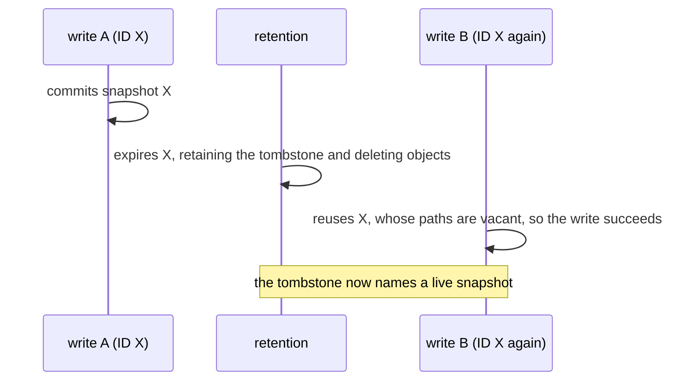

# Snapshot IDs

This guide describes how Lode structures and orders snapshot IDs (`SnapshotID`
and `volume.SnapshotID`) and why their uniqueness matters under retention.
The guide is explanatory, and
[`CONTRACT_CORE.md`](../contracts/CONTRACT_CORE.md) §Snapshot ID defines the
normative rules.

## Snapshot ID Format

Lode generates every snapshot ID, and callers never choose one. Since v0.11.0
an ID has the following form:

```
1792501720835376648-f10ae1647eb0ef59
└───────┬─────────┘ └──────┬───────┘
     instant             nonce
```

- **Instant**: the Unix time, in nanoseconds, at which the write began,
  expressed in decimal.
- **Nonce**: sixteen lowercase hexadecimal digits from a cryptographically
  secure random source.

IDs written before v0.11.0 consist of the instant alone
(`1792501720835376648`). They remain valid everywhere: reads, selection, and
retention treat both forms identically.

## Using IDs

IDs are opaque strings. Callers pass them to `Snapshot`, `Read`,
`WithAnchor`, and `ExpireRequest.IDs` verbatim and never parse them as
numbers.

Because the decimal nanosecond instant precedes the hyphen,
`ExpireRequest.Before` and `SweepRequest.Grace` determine snapshot age
directly from listed storage keys without reading manifests.

## Snapshot ID Order

Lexicographic string comparison orders IDs by start instant from
2001-09-09 01:46:40 UTC until signed 64-bit nanosecond time overflows in
April 2262. Legacy instant-only IDs sort before current IDs sharing the same
nanosecond.

When two writes begin in the same nanosecond, their random nonces decide
their lexicographic order, which does not reflect commit order. `Latest`
relies on largest-ID order only as a fallback when `latest` is missing or
names a pending snapshot without a manifest; retention never relies on ID
order to identify the head.

## Uniqueness under Retention

An expiry deletes a snapshot's manifests and data objects while leaving a
permanent tombstone at `<dataset dir>/expired/<id>`:



Without a random nonce, clock repeats (coarse clock granularity, backward NTP
steps, VM snapshot restores, or concurrent hosts) could reuse an expired ID.
The 64-bit cryptographic nonce reduces same-nanosecond collision probability
to 2⁻⁶⁴ per pair of writes, and tombstones additionally verify
`Manifest.CreatedAt` and the `(Path, SizeBytes)` object inventory before
deleting any manifest copy.
