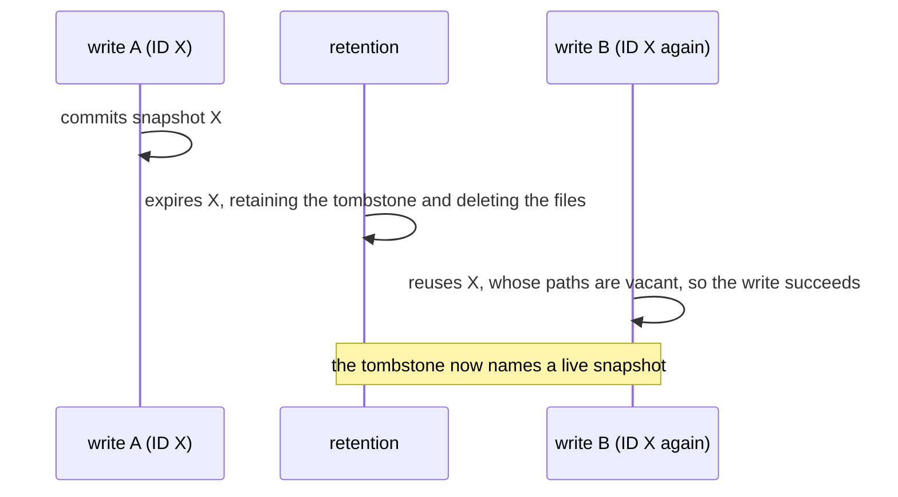

# Snapshot IDs

This guide describes how Lode structures and orders snapshot IDs and why
their uniqueness matters under retention. The guide is explanatory, and
[`CONTRACT_CORE.md`](../contracts/CONTRACT_CORE.md) §Snapshot ID defines the
normative rules.

## Snapshot ID Format

Lode generates every snapshot ID, and the caller never chooses one. Since
v0.11.0 an ID has the following form:

```
1792501720835376648-f10ae1647eb0ef59
└───────┬─────────┘ └──────┬───────┘
     instant             nonce
```

- **Instant**: the Unix time, in nanoseconds, at which the write began,
  expressed in decimal.
- **Nonce**: sixteen lowercase hexadecimal digits from a cryptographically
  secure random source.

IDs written before v0.11.0 consist of the instant alone
(`1792501720835376648`). They remain valid everywhere: reads, selection,
and retention treat both forms identically.

## Using IDs

IDs are opaque strings. Callers supply them to `Snapshot`, `Read`, and
`ExpireRequest.IDs` exactly as Lode returned them and do not parse them as
numbers, because an ID in the current form is not a number.

The instant nevertheless remains legible, so `ExpireRequest.Before` can
select snapshots from a listing without loading any manifest.

## Snapshot ID Order

String comparison orders IDs by instant, because the instant has a fixed
length of nineteen digits from 2001-09-09 01:46:40 UTC until 64-bit
nanosecond time overflows in April 2262. An ID generated by a clock set
before 2001-09-09 01:46:40 UTC has a shorter instant and sorts out of
chronological order. A legacy, instant-only ID sorts before every current ID
with the same instant.

When two writes begin in the same nanosecond, their nonces determine the
order. Nonces are random, so that order does not indicate which write
committed first. The nonce order matters only where Lode assumes that the
largest ID identifies the most recent snapshot.
`Latest` makes that assumption when the `latest` pointer is missing or names
a snapshot without a manifest (after an abandoned commit or a manual edit).
Parent resolution makes it only when the pointer is missing or does not
contain a snapshot ID. Retention never makes the assumption and declines to
run without a reliable pointer.

## Uniqueness under Retention

Before retention existed, Lode detected a repeated ID immediately: the
second write encountered the first write's manifest and failed with
`ErrPathExists`. Retention removes that safeguard, because an expiry
deletes the snapshot's manifest and data files but leaves a permanent
tombstone at `expired/<id>`:



A tombstone declares that retention is removing every object under its ID,
so retention could mistake a later snapshot that reuses the ID for the
expired one. An ID derived from the clock alone repeats whenever the clock
repeats an instant. Three conditions make a clock repeat an instant: coarse
clock resolution, a backward NTP adjustment, and a virtual-machine restore
from a saved image. Two hosts that write in the same nanosecond also
obtain the same instant. The nonce removes this dependence on the clock.

## Collisions

Two IDs coincide only when two writes begin in the same nanosecond **and**
draw the same 64-bit nonce. Each such pair of writes collides with a
probability of 1 in 2⁶⁴.
Lode does not check a new ID against existing IDs, so a collision has the
following consequences:

- **While the earlier snapshot exists**, the colliding write fails at the
  first path that both writes share. If that path is a data file, the write
  fails with `ErrPathExists` during staging, before it modifies the pointer.
  If the writes target different partitions, their data paths differ, and
  the colliding write instead fails when it creates its manifest. Lode writes
  the pointer before the manifest, so the failed write has already advanced
  the `latest` pointer. The pointer then names the shared ID, which
  resolves to the earlier snapshot, until the next commit.
- **After the earlier snapshot has expired**, its tombstone records that
  snapshot's commit time and file list, and retention applies a tombstone
  only to a manifest that the tombstone describes. Retention preserves every
  head, including the new snapshot while that snapshot remains the head.
  Once a later commit supersedes the new snapshot, an `Expire` that names
  the ID returns an error, and `Sweep` reports the tombstone in
  `Unparseable` and retains the data. One exception applies when both
  commits also complete in the same nanosecond and contain the same files:
  the old tombstone
  then describes the new snapshot, so retention can remove that snapshot.
  Retention can also delete the new write's staged data before the write
  commits its manifest. Nothing yet distinguishes that
  data from the expired snapshot's residual objects, so a `Sweep`, or an
  `Expire` that names the ID, can delete it.

Instant-only IDs collided whenever two writes began in the same nanosecond,
with the same consequences. For each pair of writes that obtain the same
instant, the nonce reduces the collision probability from certainty to
2⁻⁶⁴.
